<div dir="rtl">

<div align="center">

<sub><a href="README.md">English</a> · <a href="README.tr.md">Türkçe</a> · <a href="README.de.md">Deutsch</a> · <a href="README.es.md">Español</a> · <a href="README.fr.md">Français</a> · <a href="README.pt-BR.md">Português (BR)</a> · <a href="README.ru.md">Русский</a> · <a href="README.zh-CN.md">简体中文</a> · <a href="README.ja.md">日本語</a> · <b>العربية</b></sub>

<picture><source media="(prefers-color-scheme: light)" srcset="assets/readme/hero-light.svg"></picture>

<sub><b><a href="#what">ما هو</a> &nbsp;·&nbsp; <a href="#features">الميزات</a> &nbsp;·&nbsp; <a href="#demo">عرض</a> &nbsp;·&nbsp; <a href="#tools">الأدوات</a> &nbsp;·&nbsp; <a href="#start">البدء</a> &nbsp;·&nbsp; <a href="#commands">الأوامر</a> &nbsp;·&nbsp; <a href="#numbers">الأرقام</a> &nbsp;·&nbsp; <a href="#safety">الأمان</a> &nbsp;·&nbsp; <a href="#faq">أسئلة شائعة</a></b></sub>

<br/><br/>

**OMNIS** طبقة هندسية تعمل تحت أداة البرمجة بالذكاء الاصطناعي التي تستخدمها.<br/>
تقرأ أقل، وتُصفّي الضجيج، وتتذكّر ما تعلّمته، وتتحقق من عملها بنفسها، وتسأل قبل أي خطوة خطرة.<br/>
<sub>Python 3.8+ · المكتبة القياسية فقط · MIT · v1.2.0</sub>

<picture><source media="(prefers-color-scheme: light)" srcset="assets/readme/divider-light.svg"></picture>

<a name="what"></a>
<picture><source media="(prefers-color-scheme: light)" srcset="assets/readme/title-what-light.svg"></picture>

</div>

تستهلك وكلاء البرمجة بالذكاء الاصطناعي معظم سياقها في التعرّف على المشروع: قراءة ملفات كاملة، وسيول من مخرجات `grep`، وسجلات اختبار من 3,000 سطر. يمنحها OMNIS طرقًا أرخص للوصول إلى الإجابة نفسها، إضافةً إلى ما يحتاجه وكيل يعمل لفترة طويلة كي يبقى جديرًا بالثقة.

- **Claude Code أولًا.** skill محمّل دائمًا (`SKILL.md`، نحو 60 سطرًا) يوجّه كل مهمة إلى وضع FAST أو STANDARD أو DEEP أو DEBUG، ولا يحمّل workflows وengines إلا عند الحاجة.
- **كل الأدوات الأخرى عبر MCP.** محرّك مشترك واحد في `~/.omnis/app`، يُتاح عبر خادم MCP مكتوب بالمكتبة القياسية، ويوصله مثبّت واحد بـ Codex وGemini CLI وCursor وVS Code Copilot وغيرها.
- **نقطة دخول واحدة.** `python scripts/omnis.py <أمر>`. بلا اعتماديات، وبلا خطوة بناء، وبلا اتصالات شبكة ما لم تطلب تثبيت skill.
- **حالة كل مشروع** تُحفظ في `<المشروع>/.omnis/` (أضفه إلى `.gitignore`).

<div align="center">

<picture><source media="(prefers-color-scheme: light)" srcset="assets/readme/divider-light.svg"></picture>

<a name="features"></a>
<picture><source media="(prefers-color-scheme: light)" srcset="assets/readme/title-features-light.svg"></picture>

<a href="SKILL.md"><picture><source media="(prefers-color-scheme: light)" srcset="assets/readme/card-map-light.svg"></picture></a>
<a href="docs/BENCHMARKS.md"><picture><source media="(prefers-color-scheme: light)" srcset="assets/readme/card-filter-light.svg"></picture></a>
<a href="SKILL.md"><picture><source media="(prefers-color-scheme: light)" srcset="assets/readme/card-memory-light.svg"></picture></a>
<a href="workflows/deep.md"><picture><source media="(prefers-color-scheme: light)" srcset="assets/readme/card-checkpoint-light.svg"></picture></a>
<a href="engines/automation.md"><picture><source media="(prefers-color-scheme: light)" srcset="assets/readme/card-usage-light.svg"></picture></a>
<a href="docs/SECURITY.md"><picture><source media="(prefers-color-scheme: light)" srcset="assets/readme/card-security-light.svg"></picture></a>
<a href="config/skill-catalog.json"><picture><source media="(prefers-color-scheme: light)" srcset="assets/readme/card-skills-light.svg"></picture></a>
<a href="docs/tr/MCP.md"><picture><source media="(prefers-color-scheme: light)" srcset="assets/readme/card-mcp-light.svg"></picture></a>
<a href="install.py"><picture><source media="(prefers-color-scheme: light)" srcset="assets/readme/card-install-light.svg"></picture></a>
<a href="docs/tr/GENEL.md"><picture><source media="(prefers-color-scheme: light)" srcset="assets/readme/card-os-light.svg"></picture></a>
<a href="scripts/gateway_filter.py"><picture><source media="(prefers-color-scheme: light)" srcset="assets/readme/card-gateway-light.svg"></picture></a>
<a href="workflows/debug.md"><picture><source media="(prefers-color-scheme: light)" srcset="assets/readme/card-verify-light.svg"></picture></a>

<sub>كل بطاقة تفتح توثيقها أو شيفرتها المصدرية.</sub>

</div>

<details>
<summary><b>ماذا يفعل كل جزء</b> &nbsp;<sub>سطر واحد لكل ميزة</sub></summary>
<br/>

| الميزة | ماذا تفعل |
|---|---|
| **map** | خريطة مشروع مخزّنة مؤقتًا: اللغات، وأطر العمل، ومديرو الحزم، وأوامر run/build/test، ونقاط الدخول، والاختبارات. تدعم monorepo. لا تقرأ محتوى `.env` أبدًا. |
| **find · outline · deps** | فهرس رموز تزايدي. Python عبر AST (الثقة `high`)، وJS/TS/Go/Rust/Java/C#/PHP/Ruby عبر التعابير النمطية (`medium`). يعرض `deps` ما يستورده الملف ومن يستورده. |
| **filter** | يشغّل أمرًا ويعرض الأخطاء والتتبعات والمواضع والملخصات فقط، ويحفظ السجل الكامل ويحتفظ برمز الخروج. |
| **verify** | الملفات المعدّلة ← الاختبارات المرتبطة ← الفحوص. مع `--run` يشغّلها ويبلّغ VERIFIED أو FAILED. وينبّه إلى الملفات التي تشبه الأسرار. |
| **memory** | حقائق المشروع (القرارات، والأعراف، والمعمارية) مع تاريخ انتهاء وتحقق من المصدر، ومستودع لأنماط الأخطاء: `memory bug match "<الخطأ>"`. |
| **checkpoint** | يحفظ المهمة وما أُنجز والخطوات التالية؛ و`resume` في جلسة جديدة يعرض أيضًا تغييرات git منذ الحفظ. |
| **usage · reminder** | استهلاك token الفعلي من سجلات Claude Code المحلية، ونافذة تقديرية مدتها 5 ساعات، ورسائل الحدود. تذكيرات دورية مع ساعات هدوء وحد أقصى وتاريخ انتهاء، عبر CronCreate أو `/schedule` أو مجدول النظام. |
| **security · guard** | كشف الأسرار مع إخفائها، وتصنيف خطورة الأوامر، وخطاف PreToolUse اختياري يمنع الأوامر الكارثية ويسأل قبل الأوامر الخطرة. |
| **skills · audit · registry** | فهرس منتقى (30 skill و8 حزم جاهزة) يُثبَّت من commit مثبّت بعد تدقيق ساكن، مع ملف قفل وفحص تعارضات وتحديث وإزالة. |
| **خادم MCP** | `scripts/mcp_server.py`: JSON-RPC بالمكتبة القياسية عبر stdio، أو streamable HTTP على loopback مع bearer token. المخرجات تُخفى أسرارها دائمًا. |
| **المثبّت** | `install.py --target …` لـ 12 أداة. تشغيل تجريبي افتراضيًا، ونسخة احتياطية لكل ملف، وقابل للتكرار بلا أثر جانبي، ويحافظ على إدخالات الآخرين، ويدعم `--uninstall`. |
| **Developer OS** | `/omnis setup` لـ Claude Code: 14 وكيلًا متخصصًا، و30 أمرًا، وخطافات خفيفة، وأتمتة للقراءة فقط، وخوادم MCP بإصدارات مثبّتة، وتراجع بخطوة واحدة. |
| **مرشّح البوابة** | `scripts/gateway_filter.py`: وكيل اختياري متوافق مع OpenAI/Anthropic أمام 9Router، يُخفي الأسرار في الرسائل الصادرة. |

</details>

<div align="center">

<picture><source media="(prefers-color-scheme: light)" srcset="assets/readme/divider-light.svg"></picture>

<a name="demo"></a>
<picture><source media="(prefers-color-scheme: light)" srcset="assets/readme/title-demo-light.svg"></picture>

<picture><source media="(prefers-color-scheme: light)" srcset="assets/readme/demo-light.svg"></picture>

<sub>مخرجات حقيقية على مشروع Next.js تجريبي من 5 ملفات. اختُصر المسار المطلق فقط إلى <code>~/shop</code>.</sub>

</div>

<div align="center">

<picture><source media="(prefers-color-scheme: light)" srcset="assets/readme/divider-light.svg"></picture>

<a name="tools"></a>
<picture><source media="(prefers-color-scheme: light)" srcset="assets/readme/title-tools-light.svg"></picture>

</div>

محرّك واحد: skill داخل Claude Code، وخادم MCP لكل ما عداه. أدوات MCP: `map` و`find` و`outline` و`deps` و`filter` و`verify` و`doctor` و`security_scan` و`security_classify` و`memory_get`/`memory_add` و`checkpoint_save`/`checkpoint_resume` و`usage`. يرفض `filter` الأوامر الخطرة.

**دلالة الحالة:** **مُختبَر** = تغطيه حزمة الاختبارات وهو قيد الاستخدام · **الإعداد مُختبَر** = تعديلات المثبّت على الملفات مُختبَرة في مجلد home مؤقت، ولم يُتحقَّق من العميل الفعلي · **مكتوب، غير مُختبَر** = بُني استنادًا إلى توثيق الأداة فقط.

| الأداة | ما يعمل | أين يكتب OMNIS | حماية shell | الحالة |
|---|---|---|---|---|
| Claude Code | كل شيء: skill وCLI وDeveloper OS | `~/.claude/skills/omnis` | خطاف PreToolUse: منع + سؤال | مُختبَر |
| Codex CLI / app | أدوات MCP، إرشادات عامة | `~/.codex/config.toml`، `~/.codex/AGENTS.md` | `rules/omnis.rules` (مطابقة البادئة) + خطاف PreToolUse (منع فقط) | الإعداد مُختبَر |
| Gemini CLI | أدوات MCP، إرشادات | `~/.gemini/settings.json`، `GEMINI.md` | خطاف BeforeTool: منع فقط | الإعداد مُختبَر |
| Antigravity | أدوات MCP، قواعد عامة | `~/.gemini/antigravity/mcp_config.json` | لا شيء (لا توجد واجهة خطافات) | الإعداد مُختبَر |
| Cursor | أدوات MCP، قاعدة مشروع | `~/.cursor/mcp.json`، `.cursor/rules/omnis.mdc` | `hooks.json` beforeShellExecution | الإعداد مُختبَر |
| VS Code Copilot | أدوات MCP (وضع الوكيل)، تعليمات | `Code/User/mcp.json`، `prompts/omnis.instructions.md` | لا شيء (تأكيد Copilot الخاص) | الإعداد مُختبَر |
| Windsurf | أدوات MCP، قواعد عامة | `~/.codeium/windsurf/mcp_config.json` | لا شيء | الإعداد مُختبَر |
| Cline / Roo | أدوات MCP | ملف `mcp_settings.json` الخاص بكل منهما | لا شيء (واجهة الموافقة الخاصة بهما) | مكتوب، غير مُختبَر |
| OpenCode | أدوات MCP، إرشادات | `~/.config/opencode/opencode.json`، `AGENTS.md` | لا شيء (استخدم إعداد `permission` فيه) | الإعداد مُختبَر |
| Continue | أدوات MCP | `~/.continue/mcpServers/omnis.yaml` | لا شيء | الإعداد مُختبَر |
| أي أداة تقرأ AGENTS.md | نص القواعد | `--target agents --project DIR` | نص فقط | مُختبَر |
| ChatGPT ويب / سطح المكتب | **ليس مباشرةً.** تحتاج connectors إلى MCP بعيد عبر HTTPS | `mcp_server.py --http`: loopback فقط، bearer token، فحص Origin، و`filter` معطّل دون `--allow-exec` | – | مكتوب، غير مُختبَر |
| بوابة 9Router | إخفاء الأسرار للعملاء الذين يختارون ذلك | `gateway_filter.py` على `:20129` أمام `:20128` | يُخفي الأسرار الصادرة | مُختبَر (اختبار وحدة للوكيل) |

<details>
<summary><b>لماذا وكيل منفصل لـ 9Router</b></summary>
<br/>

لا يملك 9Router (0.5.123) مركز MCP عامًا: إضافات MCP فيه قائمة مكتوبة في الشيفرة، وقائمة "managed MCP" تُرسَل فقط إلى إعدادات Claude Cowork. ولا توجد واجهة إضافات لحقن system prompt أو لتصفية الطلبات. لذلك لا يعدّل OMNIS ملفات 9Router (فأي تحديث عبر npm سيمحو التعديل)، بل يشغّل `gateway_filter.py` كوكيل منفصل واختياري: العملاء الذين يريدون إخفاء الأسرار يستخدمون `http://127.0.0.1:20129/v1` بدلًا من `:20128/v1`.

</details>

<div align="center">

<picture><source media="(prefers-color-scheme: light)" srcset="assets/readme/divider-light.svg"></picture>

<a name="start"></a>
<picture><source media="(prefers-color-scheme: light)" srcset="assets/readme/title-start-light.svg"></picture>

</div>

انسخ المستودع ثم اختر أداتك. استخدم `python` على Windows و`python3` على macOS/Linux. كل هدف يبقى **تشغيلًا تجريبيًا** إلى أن تضيف `--yes`.

<div dir="ltr">

```bash
python3 install.py --yes                      # Claude Code skill → ~/.claude/skills/omnis
python3 install.py --with-hook --yes          # + safety hook in ~/.claude/settings.json (backed up first)
python3 install.py --os --yes                 # Claude Code Developer OS (same as /omnis setup)
python3 install.py --list-targets             # what is detected on this machine
python3 install.py --target codex --yes       # one tool: codex, gemini, antigravity, cursor, vscode,
                                              #   windsurf, cline, roo, opencode, continue, chatgpt
python3 install.py --target all --yes         # every detected tool
python3 install.py --target agents --project DIR --yes   # AGENTS.md block in one repo
python3 install.py --verify                   # run the test suite on the installed copy
```

</div>

داخل Claude Code بعد إعادة تشغيله:

<div dir="ltr">

```text
/omnis setup      audit → plan → backup → install → validate → report (Turkish)
/omnis durum      health check
/omnis geri-al    roll back the last setup   (omnis rollback list · omnis rollback <ts>)
/omnis map        start working
```

</div>

**التراجع.** كل تشغيل لـ `/omnis setup` يحفظ `settings.json` و`CLAUDE.md` وملف `manifest.json` في `~/.claude/omnis/backups/<ts>/`. يستعيد التراجع هذين الملفين، ويحذف الوكلاء والأوامر التي تحمل علامة OMNIS، ويزيل خوادم MCP والمهام المجدولة التي أضافها، ولا يلمس ملفاتك الخاصة. للأدوات الأخرى: `install.py --target <الأداة> --uninstall --yes`. تبقى النسخ الاحتياطية في `~/.omnis/backups/<ts>/`.

<sub>Windows: صُمّم له (المكتبة القياسية فقط، وطرفية UTF-8، و<code>schtasks</code>، وقواعد PowerShell في guard)، راجع <a href="docs/WINDOWS.md">docs/WINDOWS.md</a>.</sub>

<div align="center">

<picture><source media="(prefers-color-scheme: light)" srcset="assets/readme/divider-light.svg"></picture>

<a name="commands"></a>
<picture><source media="(prefers-color-scheme: light)" srcset="assets/readme/title-commands-light.svg"></picture>

</div>

<details>
<summary><b>CLI</b> &nbsp;<sub><code>python scripts/omnis.py …</code></sub></summary>
<br/>

| الأمر | ماذا يفعل |
|---|---|
| `map [ROOT] [--refresh]` | خريطة المشروع (مخزّنة مؤقتًا) |
| `find NAME` · `outline FILE` · `deps FILE` | البحث عن رمز، وهيكل الملف، ورسم الاستيرادات |
| `index [ROOT]` | بناء فهرس الرموز أو تحديثه |
| `filter "<cmd>"` | تشغيل أمر وعرض المهم فقط |
| `verify [--run]` | فحوص للتغييرات الحالية |
| `doctor` | النظام وshell والأدوات والقرص؛ أسماء متغيرات البيئة فقط |
| `security scan\|diff\|classify` | الأسرار وخطورة الأوامر |
| `memory add\|search\|inspect\|cleanup` · `memory bug add\|match` | ذاكرة المشروع وأنماط الأخطاء |
| `checkpoint save\|resume\|list` | نقاط حفظ المهام |
| `usage [status\|report\|setup\|limits]` | استهلاك token من السجلات المحلية |
| `reminder add\|list\|pause\|resume\|set\|remove\|cron\|os-install` | تذكيرات دورية |
| `skills presets\|search\|plan\|install\|list\|conflicts\|update\|remove` | فهرس skills الخارجية ومثبّتها |
| `audit PATH` | تدقيق أمني ساكن لمجلد skill |
| `benchmark repo\|filter\|sessions` | قياس التوفير |
| `setup` · `durum` · `geri-al [TS]` | Developer OS: تثبيت + تحقق، والصحة، والتراجع |
| `os-audit` | ما المثبّت، والتكرارات، والتعارضات |
| `registry [--dupes]` | سجل skills |
| `adapt [ROOT]` | اكتشاف التقنيات المستخدمة وskills المناسبة |
| `automation …` | مهام مجدولة للقراءة فقط مع إشعار |
| `clean [ROOT]` | حذف ذاكرة التخزين المؤقت لهذا المشروع (تبقى الذاكرة ونقاط الحفظ) |

</details>

<details>
<summary><b>أوامر الشرطة المائلة في Claude Code</b> &nbsp;<sub>يثبّتها <code>/omnis setup</code></sub></summary>
<br/>

الأسماء التي تتعارض مع أوامر مدمجة أو أوامر إضافات تأخذ البادئة `omnis-`. لا تُلمس الملفات التي كتبتها بنفسك أبدًا.

| الأمر | ماذا يفعل |
|---|---|
| `/analyze` | فهم منطقة ما قبل تغييرها |
| `/omnis-plan` | خطة يمكن التحقق من كل خطوة فيها (وضع DEEP) |
| `/implement` | من البداية للنهاية: خطة، تعديل، اختبار، تحقق |
| `/omnis-debug` | السبب الجذري، والإصلاح، واختبار انحدار، وحفظ الخطأ في الذاكرة |
| `/audit` | تدقيق صحة عام، لا يغيّر شيئًا |
| `/omnis-security` | مراجعة أمنية لـ diff أو لمنطقة |
| `/omnis-review` | مراجعة diff بواسطة الوكيل code-reviewer |
| `/test` | تشغيل الاختبارات التي يمسّها التغيير فقط |
| `/optimize` | قِس، أصلِح، ثم قِس مجددًا |
| `/refactor` | إعادة الهيكلة دون تغيير السلوك |
| `/omnis-docs` | كتابة التوثيق من الشيفرة الفعلية |
| `/release` · `/deploy` | تجهيز إصدار / النشر، وكلاهما يسأل أولًا |
| `/cleanup` | سرد الشيفرة والملفات الميتة، والحذف بعد الموافقة فقط |
| `/research` | الإجابة من مصادر رسمية مع ذكر المراجع |
| `/project-onboard` | اكتشاف التقنيات واقتراح skills ووكلاء |
| `/task-report` | الإبلاغ عن الحالة وحفظ نقطة حفظ |
| `/skills-discover` `/skills-install` `/skills-update` `/skills-audit` `/skills-remove` `/skills-list` | فهرس skills وسجلّها |
| `/automation-status` `/automation-add` `/automation-pause` `/automation-resume` `/automation-remove` `/automation-config` `/automation-run` | مدير الأتمتة |

</details>

<details>
<summary><b>الوكلاء والخطافات والأتمتة</b> &nbsp;<sub>Developer OS</sub></summary>
<br/>

**الوكلاء** (`~/.claude/agents/`؛ يُتخطّى الوكيل إن وُجد آخر بالاسم نفسه في إضافة أو في ملفاتك)
- للقراءة فقط: architect وsecurity-auditor وcode-reviewer وdebugger وperformance وui-ux وresearch.
- يعدّلون الملفات: developer وfrontend وbackend وdatabase وdocs وqa (ملفات الاختبار فقط) وdevops (الإعدادات فقط، ولا ينشر أبدًا).
- لا وكلاء للمهام الصغيرة؛ ولا يعدّل وكيلان الملف نفسه؛ ويعمل code-reviewer بعد كتابة الشيفرة، ومعه security-auditor إذا تغيّرت شيفرة المصادقة أو الدفع أو الملفات أو shell.

**الخطافات** (`scripts/os_hooks.py`؛ فشل أي خطاف لا يكسر الجلسة)

| الحدث | ماذا يفعل |
|---|---|
| PreToolUse Bash/PowerShell | `guard.py`: يمنع الأوامر الكارثية ويسأل قبل الخطرة |
| PreToolUse Edit/Write | يسأل قبل الكتابة إلى ملفات `.env*` والمفاتيح وملفات القفل |
| PostToolUse Edit/Write | يفحص الملف المعدَّل بحثًا عن أسرار؛ ويشغّل prettier/eslint إن وُجدا في المشروع |
| Stop | `tsc --noEmit` إذا تغيّر ملف .ts/.tsx (يوقف الدور مرة واحدة على الأكثر)؛ وإشعار بعد المهام الطويلة |
| SessionStart · PreCompact | استعادة / حفظ نقطة حفظ المهمة |

**الأتمتة** (`scripts/automation.py`، في مجدول مهام Windows باسم `OMNIS\<id>`): `skill-update-check` و`dependency-advisories` و`repo-health`. الفواصل 1 أو 2 أو 3 أو 5 (افتراضي) أو 8 أو 12 أو 24 ساعة. المهام تقرأ فقط، وتكتب تقريرًا في `~/.omnis/reports/`، وتعرض إشعارًا.

**خوادم MCP** التي يضيفها الإعداد (بلا بيانات اعتماد، بإصدارات مثبّتة): `@upstash/context7-mcp@4.6.0` و`@playwright/mcp@0.0.84`.

</details>

<div align="center">

<picture><source media="(prefers-color-scheme: light)" srcset="assets/readme/divider-light.svg"></picture>

<a name="numbers"></a>
<picture><source media="(prefers-color-scheme: light)" srcset="assets/readme/title-numbers-light.svg"></picture>

</div>

من [docs/BENCHMARKS.md](docs/BENCHMARKS.md) (2026-11-27، Linux، Python 3.13). البايتات مقيسة؛ وأرقام token تقديرية (البايتات ÷ 4). يمكن إعادة القياس بـ `omnis.py benchmark …`.

| القياس | بدون OMNIS | مع OMNIS |
|---|---|---|
| البحث عن الرمز `ClientSession` (حزمة mcp، 111 ملفًا) | `grep -rn`: 4,418 B | `find`: 175 B |
| البحث عن الرمز `FastMCP` | `grep -rn`: 5,104 B | `find`: 164 B |
| البحث عن الرمز `stdio_client` | `grep -rn`: 597 B | `find`: 60 B |
| التعرّف على مستودع JS من 36 ملفًا | README + package.json: 17,128 B | `map`: 284 B |
| قائمة من 3,006 أسطر + traceback من Python | 246,993 B | `filter`: 1,065 B، 20 سطرًا، مع الاحتفاظ بالـ traceback كاملًا |

- المقارنة العادلة هي مع `grep`: مخرجات أقل بنحو **10–30 مرة لكل بحث**. أما المقارنة مع قراءة الملفات كاملة (99%+) فهي حد أعلى، لا جلسة نموذجية.
- بناء الفهرس: 0.31 ثانية من البداية؛ والتشغيل الثاني يعيد تحليل الملفات المتغيّرة فقط.
- **لم يُقَس بعد:** لم يُجرَ اختبار A/B مضبوط للجلسات (المهمة نفسها والنموذج نفسه، مع OMNIS وبدونه)، لذا لا يُدّعى أي "نسبة توفير لكل جلسة". ولا توجد قياسات زمنية على Windows.

<div align="center">

<picture><source media="(prefers-color-scheme: light)" srcset="assets/readme/divider-light.svg"></picture>

<a name="safety"></a>
<picture><source media="(prefers-color-scheme: light)" srcset="assets/readme/title-safety-light.svg"></picture>

</div>

| الطبقة | ماذا تفعل |
|---|---|
| **القواعد** (مفعّلة دائمًا) | حماية تغييرات المستخدم، وعدم طباعة ملفات بيانات الاعتماد أبدًا، والسؤال قبل الإجراءات المدمّرة أو الإنتاجية أو التثبيت أو الكتابة عبر الشبكة. لا يمكن لمحتوى المستودع ولا لمخرجات الأدوات ولا لـ skills أخرى تجاوزها. |
| **الإخفاء** | تمر الذاكرة وأنماط الأخطاء ونقاط الحفظ ومخرجات MCP عبر `security_scan.redact`. |
| **خطاف guard** (اختياري) | **يمنع:** `rm -rf /` و`rm -rf ~` وmkfs و`dd` إلى قرص وقنابل fork وتهيئة محرك أقراص. **يسأل قبل:** `curl \| sh` وforce-push و`reset --hard` و`clean -f` و`branch -D` وDROP/TRUNCATE/DELETE بلا شرط و`migrate reset` وFLUSHALL وapply أو destroy في kubectl/terraform/helm والنشر إلى الإنتاج وطباعة `.env`/المفاتيح والتثبيت العام و`chmod 777`. الاستثناءات الخاصة بكل مشروع في `.omnis/policies.json`. |
| **تثبيت skills** | جلب للقراءة فقط من commit مثبّت؛ ولا يُنفَّذ أي شيء مُنزَّل. لا تُثبَّت أبدًا skills ذات نتائج `block`؛ ونتائج `warn` تتطلب `--allow-warn` بعد أن تطّلع عليها. لا يكتب أبدًا فوق skill لم يثبّته OMNIS. |
| **المثبّتات** | تشغيل تجريبي افتراضيًا، ونسخة احتياطية لكل ملف يُمَس، وقابلة للتكرار، وتحافظ على إدخالات الآخرين، و`--uninstall` لكل هدف. |
| **الشبكة** | يرتبط HTTP الخاص بـ MCP بعنوان loopback مع token، ويرفض الارتباط بعنوان عام دون `--allow-remote`. |

> الخطاف قائم على الأنماط: حزام أمان، لا sandbox. كشف الأسرار بالتعابير النمطية يلتقط الصيغ الشائعة، لا كل token مخصص. وتدقيق skills ساكن. التفاصيل: [docs/SECURITY.md](docs/SECURITY.md).

<div align="center">

<picture><source media="(prefers-color-scheme: light)" srcset="assets/readme/divider-light.svg"></picture>

<a name="faq"></a>
<picture><source media="(prefers-color-scheme: light)" srcset="assets/readme/title-faq-light.svg"></picture>

</div>

<details>
<summary><b>هل يحتاج إلى حزم؟</b></summary>
<br/>لا. Python 3.8+ والمكتبة القياسية فقط. خوادم MCP الاختيارية التي يضيفها <code>/omnis setup</code> تعمل عبر <code>npx</code>.
</details>

<details>
<summary><b>كم يوفّر في كل جلسة؟</b></summary>
<br/>بصراحة، غير معروف. عمليات البحث والسجلات تصغر كثيرًا (راجع <a href="#numbers">الأرقام</a>)، لكن لا يوجد بعدُ قياس A/B مضبوط للجلسات. استخدم <code>omnis.py benchmark sessions --split &lt;تاريخ التثبيت&gt;</code> لمقارنة أعمالك المتشابهة.
</details>

<details>
<summary><b>هل يستطيع قراءة حدود خطتي ووقت إعادة الضبط؟</b></summary>
<br/>لا. يقرأ <code>usage</code> سجلات Claude Code المحلية فقط، ونافذة الساعات الخمس تقديرية. الحدود الدقيقة وأوقات إعادة الضبط موجودة فقط في <code>/usage</code> الخاص بـ Claude Code. يمكنك إخبار OMNIS بأوقات إعادة الضبط عبر <code>usage setup --reset</code>.
</details>

<details>
<summary><b>هل يعمل على Windows؟</b></summary>
<br/>صُمّم لـ Windows (المكتبة القياسية فقط، ومخرجات UTF-8، و<code>schtasks</code>، وقواعد PowerShell)، لكن التطوير وحزمة الاختبارات جريا على Linux. شغّل <code>python install.py --verify</code> قبل الاعتماد عليه.
</details>

<details>
<summary><b>ما دقة <code>find</code> خارج Python؟</b></summary>
<br/>تستخدم Python شجرة AST (<code>high</code>). وتستخدم اللغات الأخرى التعابير النمطية (<code>medium</code>)، لذا تحقّق بقراءة محدودة قبل أي تعديل خطِر. لا يستطيع <code>deps</code> حل الأسماء المستعارة للمسارات ولا الاستيرادات الديناميكية.
</details>

<details>
<summary><b>لماذا لا يستطيع ChatGPT استخدامه مباشرةً؟</b></summary>
<br/>تحتاج connectors في ChatGPT إلى خادم MCP بعيد عبر HTTPS. يوفّر OMNIS وضع HTTP على loopback فقط مع token؛ وكشفه للإنترنت قرارك ومسؤوليتك.
</details>

<details>
<summary><b>هل تعمل التذكيرات و Claude Code مغلق؟</b></summary>
<br/>التذكيرات داخل الجلسة تحتاج إلى جلسة مفتوحة. تذكيرات النظام تعمل والجلسة مغلقة لكنها ترسل إشعارًا فقط ولا تقود Claude. ولا يستطيع cron تنفيذ دورة دقيقة مدتها 5 ساعات تعبر منتصف الليل.
</details>

<details>
<summary><b>كيف أزيل كل شيء؟</b></summary>
<br/><code>/omnis geri-al</code> لـ Developer OS، و<code>install.py --uninstall --yes</code> للـ skill والخطاف، و<code>install.py --target &lt;الأداة&gt; --uninstall --yes</code> لكل أداة أخرى، و<code>omnis.py clean</code> لذاكرة التخزين المؤقت لمشروع ما.
</details>

<details>
<summary><b>ما التالي؟</b></summary>
<br/>منصة قياس A/B · CI على Windows · محللات tree-sitter لـ TS/Go · اختيار الاختبارات المتأثرة من بيانات التغطية · مصادر فهرس إضافية بعد تدقيقها.
</details>

<div align="center">

<picture><source media="(prefers-color-scheme: light)" srcset="assets/readme/divider-light.svg"></picture>

<sub>التوثيق: <a href="SKILL.md">SKILL.md</a> · <a href="docs/BENCHMARKS.md">BENCHMARKS</a> · <a href="docs/SECURITY.md">SECURITY</a> · <a href="docs/WINDOWS.md">WINDOWS</a> · <a href="docs/ECOSYSTEM_RESEARCH.md">ECOSYSTEM_RESEARCH</a> · <a href="docs/tr/GENEL.md">docs/tr</a> · <a href="CHANGELOG.md">CHANGELOG</a></sub>

<sub><a href="LICENSE">ترخيص MIT</a> · رسومات SVG يولّدها <a href="tools/readme_assets.py">tools/readme_assets.py</a></sub>

</div>

</div>
