<div align="center">

<sub><a href="README.md">English</a> · <a href="README.tr.md">Türkçe</a> · <b>Deutsch</b> · <a href="README.es.md">Español</a> · <a href="README.fr.md">Français</a> · <a href="README.pt-BR.md">Português (BR)</a> · <a href="README.ru.md">Русский</a> · <a href="README.zh-CN.md">简体中文</a> · <a href="README.ja.md">日本語</a> · <a href="README.ar.md">العربية</a></sub>

<picture><source media="(prefers-color-scheme: light)" srcset="assets/readme/hero-light.svg"></picture>

<sub><b><a href="#what">WAS</a> &nbsp;·&nbsp; <a href="#features">FUNKTIONEN</a> &nbsp;·&nbsp; <a href="#demo">DEMO</a> &nbsp;·&nbsp; <a href="#tools">TOOLS</a> &nbsp;·&nbsp; <a href="#start">START</a> &nbsp;·&nbsp; <a href="#commands">BEFEHLE</a> &nbsp;·&nbsp; <a href="#numbers">ZAHLEN</a> &nbsp;·&nbsp; <a href="#safety">SICHERHEIT</a> &nbsp;·&nbsp; <a href="#faq">FAQ</a></b></sub>

<br/><br/>

**OMNIS** ist eine Engineering-Schicht, die unter deinem AI-Coding-Tool liegt.<br/>
Sie liest weniger, filtert Rauschen, merkt sich Gelerntes, prüft ihre eigene Arbeit und fragt vor allem Gefährlichen nach.<br/>
<sub>Python 3.8+ · nur Standardbibliothek · MIT · v1.2.0</sub>

<picture><source media="(prefers-color-scheme: light)" srcset="assets/readme/divider-light.svg"></picture>

<a name="what"></a>
<picture><source media="(prefers-color-scheme: light)" srcset="assets/readme/title-what-light.svg"></picture>

</div>

AI-Coding-Agents verbrauchen den Großteil ihres Kontexts für die Orientierung: ganze Dateien lesen, `grep`-Fluten, Testlogs mit 3.000 Zeilen. OMNIS liefert dieselbe Antwort auf günstigerem Weg und ergänzt die Teile, die ein lange laufender Agent braucht, um vertrauenswürdig zu bleiben.

- **Claude Code zuerst.** Ein Skill (`SKILL.md`, etwa 60 Zeilen, immer geladen) leitet jede Aufgabe in den Modus FAST, STANDARD, DEEP oder DEBUG und lädt Workflows und Engines nur bei Bedarf.
- **Jedes andere Tool über MCP.** Eine gemeinsame Engine in `~/.omnis/app`, bereitgestellt über einen MCP-Server aus reiner Standardbibliothek, per Installer in Codex, Gemini CLI, Cursor, VS Code Copilot und weitere eingebunden.
- **Ein Einstiegspunkt.** `python scripts/omnis.py <befehl>`. Keine Abhängigkeiten, kein Build-Schritt, keine Netzwerkzugriffe, außer du installierst einen Skill.
- **Projektzustand** liegt in `<projekt>/.omnis/` (in `.gitignore` aufnehmen).

<div align="center">

<picture><source media="(prefers-color-scheme: light)" srcset="assets/readme/divider-light.svg"></picture>

<a name="features"></a>
<picture><source media="(prefers-color-scheme: light)" srcset="assets/readme/title-features-light.svg"></picture>

<a href="SKILL.md"><picture><source media="(prefers-color-scheme: light)" srcset="assets/readme/card-map-light.svg"></picture></a>
<a href="docs/BENCHMARKS.md"><picture><source media="(prefers-color-scheme: light)" srcset="assets/readme/card-filter-light.svg"></picture></a>
<a href="SKILL.md"><picture><source media="(prefers-color-scheme: light)" srcset="assets/readme/card-memory-light.svg"></picture></a>
<a href="workflows/deep.md"><picture><source media="(prefers-color-scheme: light)" srcset="assets/readme/card-checkpoint-light.svg"></picture></a>
<a href="engines/automation.md"><picture><source media="(prefers-color-scheme: light)" srcset="assets/readme/card-usage-light.svg"></picture></a>
<a href="docs/SECURITY.md"><picture><source media="(prefers-color-scheme: light)" srcset="assets/readme/card-security-light.svg"></picture></a>
<a href="config/skill-catalog.json"><picture><source media="(prefers-color-scheme: light)" srcset="assets/readme/card-skills-light.svg"></picture></a>
<a href="docs/tr/MCP.md"><picture><source media="(prefers-color-scheme: light)" srcset="assets/readme/card-mcp-light.svg"></picture></a>
<a href="install.py"><picture><source media="(prefers-color-scheme: light)" srcset="assets/readme/card-install-light.svg"></picture></a>
<a href="docs/tr/GENEL.md"><picture><source media="(prefers-color-scheme: light)" srcset="assets/readme/card-os-light.svg"></picture></a>
<a href="scripts/gateway_filter.py"><picture><source media="(prefers-color-scheme: light)" srcset="assets/readme/card-gateway-light.svg"></picture></a>
<a href="workflows/debug.md"><picture><source media="(prefers-color-scheme: light)" srcset="assets/readme/card-verify-light.svg"></picture></a>

<sub>Jede Karte öffnet ihre Doku oder ihren Quellcode.</sub>

</div>

<details>
<summary><b>Was jedes Teil tut</b> &nbsp;<sub>eine Zeile pro Funktion</sub></summary>
<br/>

| Funktion | Was sie tut |
|---|---|
| **map** | Gecachte Projektkarte: Sprachen, Frameworks, Paketmanager, Run/Build/Test-Befehle, Einstiegspunkte, Tests. Monorepo-fähig. Liest nie den Inhalt von `.env`. |
| **find · outline · deps** | Inkrementeller Symbolindex. Python per AST (Konfidenz `high`), JS/TS/Go/Rust/Java/C#/PHP/Ruby per Regex (`medium`). `deps` zeigt Imports und wer eine Datei importiert. |
| **filter** | Führt einen Befehl aus, zeigt nur Fehler, Traces, Stellen und Zusammenfassungen, speichert das volle Log und behält den Exit-Code. |
| **verify** | Geänderte Dateien → zugehörige Tests → Checks. Mit `--run` werden sie ausgeführt und als VERIFIED oder FAILED gemeldet. Markiert Dateien, die nach Secrets aussehen. |
| **memory** | Projektfakten (Entscheidungen, Konventionen, Architektur) mit Ablaufdatum und Quellprüfung, dazu ein Speicher für Bug-Muster: `memory bug match "<fehler>"`. |
| **checkpoint** | Speichert Aufgabe, Erledigtes und nächste Schritte; `resume` zeigt in einer neuen Session auch die Git-Änderungen seitdem. |
| **usage · reminder** | Echter Token-Verbrauch aus lokalen Claude-Code-Transkripten, ein heuristisches 5-Stunden-Fenster, Limit-Meldungen. Wiederkehrende Erinnerungen mit Ruhezeiten, Höchstzahl und Ablauf, über CronCreate, `/schedule` oder den OS-Scheduler. |
| **security · guard** | Secret-Erkennung mit Schwärzung, Risikoklassen für Befehle und ein optionaler PreToolUse-Hook, der katastrophale Befehle blockiert und vor riskanten nachfragt. |
| **skills · audit · registry** | Kuratierter Katalog (30 Skills, 8 Presets), installiert aus festen Commits nach einem statischen Audit, mit Lock-Datei, Konfliktprüfung, Update und Entfernen. |
| **MCP-Server** | `scripts/mcp_server.py`: JSON-RPC aus der Standardbibliothek über stdio oder Loopback-Streamable-HTTP mit Bearer-Token. Ausgaben werden immer geschwärzt. |
| **Installer** | `install.py --target …` für 12 Tools. Standardmäßig Probelauf, sichert jede Datei, idempotent, lässt fremde Einträge stehen, hat `--uninstall`. |
| **Developer OS** | `/omnis setup` für Claude Code: 14 Spezial-Agents, 30 Befehle, günstige Hooks, Read-only-Automatisierung, versionierte MCP-Server, Rollback in einem Schritt. |
| **Gateway-Filter** | `scripts/gateway_filter.py`: ein optionaler, OpenAI/Anthropic-kompatibler Proxy vor 9Router, der Secrets in ausgehenden Nachrichten maskiert. |

</details>

<div align="center">

<picture><source media="(prefers-color-scheme: light)" srcset="assets/readme/divider-light.svg"></picture>

<a name="demo"></a>
<picture><source media="(prefers-color-scheme: light)" srcset="assets/readme/title-demo-light.svg"></picture>

<picture><source media="(prefers-color-scheme: light)" srcset="assets/readme/demo-light.svg"></picture>

<sub>Echte Ausgabe in einem Next.js-Beispielprojekt mit 5 Dateien. Nur der absolute Pfad ist zu <code>~/shop</code> gekürzt.</sub>

</div>

<div align="center">

<picture><source media="(prefers-color-scheme: light)" srcset="assets/readme/divider-light.svg"></picture>

<a name="tools"></a>
<picture><source media="(prefers-color-scheme: light)" srcset="assets/readme/title-tools-light.svg"></picture>

</div>

Eine Engine: als Skill in Claude Code, als MCP-Server für alles andere. MCP-Tools: `map`, `find`, `outline`, `deps`, `filter`, `verify`, `doctor`, `security_scan`, `security_classify`, `memory_get`/`memory_add`, `checkpoint_save`/`checkpoint_resume`, `usage`. `filter` lehnt riskante Befehle ab.

**Status:** **Getestet** = von der Testsuite abgedeckt und im Einsatz · **Konfig getestet** = die Dateiänderungen des Installers sind gegen ein temporäres Home getestet; der echte Client wurde nicht geprüft · **Geschrieben, nicht getestet** = nur anhand der Doku des Tools gebaut.

| Tool | Was funktioniert | Wo OMNIS schreibt | Shell-Schutz | Status |
|---|---|---|---|---|
| Claude Code | Alles: Skill, CLI, Developer OS | `~/.claude/skills/omnis` | PreToolUse-Hook: blockieren + fragen | Getestet |
| Codex CLI / App | MCP-Tools, globale Hinweise | `~/.codex/config.toml`, `~/.codex/AGENTS.md` | `rules/omnis.rules` (Präfix-Abgleich) + PreToolUse-Hook (nur blockieren) | Konfig getestet |
| Gemini CLI | MCP-Tools, Hinweise | `~/.gemini/settings.json`, `GEMINI.md` | BeforeTool-Hook: nur blockieren | Konfig getestet |
| Antigravity | MCP-Tools, globale Regeln | `~/.gemini/antigravity/mcp_config.json` | keiner (keine Hook-API) | Konfig getestet |
| Cursor | MCP-Tools, Projektregel | `~/.cursor/mcp.json`, `.cursor/rules/omnis.mdc` | `hooks.json` beforeShellExecution | Konfig getestet |
| VS Code Copilot | MCP-Tools (Agent-Modus), Anweisungen | `Code/User/mcp.json`, `prompts/omnis.instructions.md` | keiner (Copilots eigene Bestätigung) | Konfig getestet |
| Windsurf | MCP-Tools, globale Regeln | `~/.codeium/windsurf/mcp_config.json` | keiner | Konfig getestet |
| Cline / Roo | MCP-Tools | deren `mcp_settings.json` | keiner (eigene Freigabe-UI) | Geschrieben, nicht getestet |
| OpenCode | MCP-Tools, Hinweise | `~/.config/opencode/opencode.json`, `AGENTS.md` | keiner (`permission`-Konfig nutzen) | Konfig getestet |
| Continue | MCP-Tools | `~/.continue/mcpServers/omnis.yaml` | keiner | Konfig getestet |
| Jedes AGENTS.md-Tool | Regeltext | `--target agents --project DIR` | nur Text | Getestet |
| ChatGPT Web / Desktop | **Nicht direkt.** Connectors brauchen einen Remote-MCP über HTTPS | `mcp_server.py --http`: nur Loopback, Bearer-Token, Origin-Prüfung, `filter` aus ohne `--allow-exec` | – | Geschrieben, nicht getestet |
| 9Router-Gateway | Secret-Maskierung für Clients, die mitmachen | `gateway_filter.py` auf `:20129` vor `:20128` | maskiert ausgehende Secrets | Getestet (Proxy-Unit-Test) |

<details>
<summary><b>Warum ein eigener Proxy für 9Router</b></summary>
<br/>

9Router (0.5.123) hat keinen allgemeinen MCP-Hub: Seine MCP-Plugins sind eine fest codierte Liste, und die „managed MCP“-Liste wird nur in die Claude-Cowork-Konfiguration geschrieben. Es gibt keine Plugin-API für System-Prompts oder Request-Filter. Deshalb patcht OMNIS 9Router nicht (ein npm-Update würde den Patch löschen), sondern startet `gateway_filter.py` als separaten, optionalen Proxy: Clients, die Maskierung wollen, nutzen `http://127.0.0.1:20129/v1` statt `:20128/v1`.

</details>

<div align="center">

<picture><source media="(prefers-color-scheme: light)" srcset="assets/readme/divider-light.svg"></picture>

<a name="start"></a>
<picture><source media="(prefers-color-scheme: light)" srcset="assets/readme/title-start-light.svg"></picture>

</div>

Repo klonen, dann das Tool wählen. Unter Windows `python`, unter macOS/Linux `python3`. Jedes Ziel ist ein **Probelauf**, bis du `--yes` anhängst.

```bash
python3 install.py --yes                      # Claude-Code-Skill → ~/.claude/skills/omnis
python3 install.py --with-hook --yes          # + Sicherheits-Hook in ~/.claude/settings.json (vorher gesichert)
python3 install.py --os --yes                 # Claude Code Developer OS (wie /omnis setup)
python3 install.py --list-targets             # was auf diesem Rechner erkannt wird
python3 install.py --target codex --yes       # ein Tool: codex, gemini, antigravity, cursor, vscode,
                                              #   windsurf, cline, roo, opencode, continue, chatgpt
python3 install.py --target all --yes         # alle erkannten Tools
python3 install.py --target agents --project DIR --yes   # AGENTS.md-Block in einem Repo
python3 install.py --verify                   # Testsuite auf der installierten Kopie ausführen
```

In Claude Code, nach einem Neustart:

```text
/omnis setup      Audit → Plan → Backup → Installation → Prüfung → Bericht (Türkisch)
/omnis durum      Health-Check
/omnis geri-al    letztes Setup zurückrollen   (omnis rollback list · omnis rollback <ts>)
/omnis map        loslegen
```

**Zurückrollen.** Jedes `/omnis setup` sichert `settings.json`, `CLAUDE.md` und ein `manifest.json` nach `~/.claude/omnis/backups/<ts>/`. Der Rollback stellt diese beiden Dateien wieder her, löscht von OMNIS markierte Agents und Befehle, entfernt hinzugefügte MCP-Server und geplante Jobs und lässt deine eigenen Dateien in Ruhe. Für andere Tools: `install.py --target <tool> --uninstall --yes`. Backups bleiben in `~/.omnis/backups/<ts>/`.

<sub>Windows: dafür ausgelegt (nur Standardbibliothek, UTF-8-Konsole, <code>schtasks</code>, PowerShell-Regeln im Guard), siehe <a href="docs/WINDOWS.md">docs/WINDOWS.md</a>.</sub>

<div align="center">

<picture><source media="(prefers-color-scheme: light)" srcset="assets/readme/divider-light.svg"></picture>

<a name="commands"></a>
<picture><source media="(prefers-color-scheme: light)" srcset="assets/readme/title-commands-light.svg"></picture>

</div>

<details>
<summary><b>CLI</b> &nbsp;<sub><code>python scripts/omnis.py …</code></sub></summary>
<br/>

| Befehl | Was er tut |
|---|---|
| `map [ROOT] [--refresh]` | Projektkarte (gecacht) |
| `find NAME` · `outline FILE` · `deps FILE` | Symbolsuche, Datei-Gliederung, Import-Graph |
| `index [ROOT]` | Symbolindex erstellen oder aktualisieren |
| `filter "<cmd>"` | Befehl ausführen, nur Wichtiges zeigen |
| `verify [--run]` | Checks für die aktuellen Änderungen |
| `doctor` | OS, Shell, Tools, Platte; nur Namen von Umgebungsvariablen |
| `security scan\|diff\|classify` | Secrets und Befehlsrisiko |
| `memory add\|search\|inspect\|cleanup` · `memory bug add\|match` | Projektgedächtnis und Bug-Muster |
| `checkpoint save\|resume\|list` | Aufgaben-Checkpoints |
| `usage [status\|report\|setup\|limits]` | Token-Verbrauch aus lokalen Transkripten |
| `reminder add\|list\|pause\|resume\|set\|remove\|cron\|os-install` | Wiederkehrende Erinnerungen |
| `skills presets\|search\|plan\|install\|list\|conflicts\|update\|remove` | Externer Skill-Katalog und Installer |
| `audit PATH` | Statisches Security-Audit eines Skill-Ordners |
| `benchmark repo\|filter\|sessions` | Einsparung messen |
| `setup` · `durum` · `geri-al [TS]` | Developer OS: Installation + Prüfung, Status, Rollback |
| `os-audit` | Was installiert ist, Duplikate, Konflikte |
| `registry [--dupes]` | Skill-Registry |
| `adapt [ROOT]` | Stack-Erkennung und passende Skills |
| `automation …` | Read-only geplante Jobs mit Benachrichtigung |
| `clean [ROOT]` | Caches dieses Projekts löschen (Gedächtnis und Checkpoints bleiben) |

</details>

<details>
<summary><b>Slash-Befehle in Claude Code</b> &nbsp;<sub>installiert von <code>/omnis setup</code></sub></summary>
<br/>

Namen, die mit eingebauten oder Plugin-Befehlen kollidieren, bekommen das Präfix `omnis-`. Selbst geschriebene Dateien werden nie angefasst.

| Befehl | Was er tut |
|---|---|
| `/analyze` | Einen Bereich verstehen, bevor man ihn ändert |
| `/omnis-plan` | Ein Plan, dessen Schritte alle prüfbar sind (DEEP-Modus) |
| `/implement` | Durchgängig: Plan, Bearbeitung, Test, Prüfung |
| `/omnis-debug` | Ursache, Fix, Regressionstest, Bug im Gedächtnis speichern |
| `/audit` | Allgemeines Health-Audit, ändert nichts |
| `/omnis-security` | Security-Review eines Diffs oder Bereichs |
| `/omnis-review` | Diff mit dem Agent code-reviewer prüfen |
| `/test` | Nur die Tests ausführen, die die Änderung berührt |
| `/optimize` | Messen, beheben, erneut messen |
| `/refactor` | Umbauen, ohne das Verhalten zu ändern |
| `/omnis-docs` | Doku anhand des echten Codes schreiben |
| `/release` · `/deploy` | Release vorbereiten / deployen, beide fragen vorher |
| `/cleanup` | Toten Code und Dateien auflisten, nur nach Freigabe löschen |
| `/research` | Antworten aus offiziellen Quellen, mit Belegen |
| `/project-onboard` | Stack erkennen, Skills und Agents vorschlagen |
| `/task-report` | Status melden und Checkpoint speichern |
| `/skills-discover` `/skills-install` `/skills-update` `/skills-audit` `/skills-remove` `/skills-list` | Skill-Katalog und Registry |
| `/automation-status` `/automation-add` `/automation-pause` `/automation-resume` `/automation-remove` `/automation-config` `/automation-run` | Automatisierungs-Manager |

</details>

<details>
<summary><b>Agents, Hooks und Automatisierung</b> &nbsp;<sub>Developer OS</sub></summary>
<br/>

**Agents** (`~/.claude/agents/`, übersprungen, wenn ein Plugin oder eine eigene Datei denselben Namen hat)
- Nur lesend: architect, security-auditor, code-reviewer, debugger, performance, ui-ux, research.
- Bearbeitend: developer, frontend, backend, database, docs, qa (nur Testdateien), devops (nur Konfiguration, deployt nie).
- Keine Agents für kleine Aufgaben; zwei Agents bearbeiten nie dieselbe Datei; nach dem Schreiben läuft code-reviewer, bei Änderungen an Auth, Zahlungen, Datei- oder Shell-Code zusätzlich security-auditor.

**Hooks** (`scripts/os_hooks.py`; ein fehlerhafter Hook bricht die Session nie)

| Ereignis | Was er tut |
|---|---|
| PreToolUse Bash/PowerShell | `guard.py`: katastrophale Befehle blockieren, vor riskanten fragen |
| PreToolUse Edit/Write | Vor dem Schreiben von `.env*`-, Schlüssel- und Lock-Dateien fragen |
| PostToolUse Edit/Write | Bearbeitete Datei auf Secrets prüfen; prettier/eslint ausführen, falls vorhanden |
| Stop | `tsc --noEmit`, wenn .ts/.tsx geändert wurde (blockiert höchstens einmal); Benachrichtigung nach langen Aufgaben |
| SessionStart · PreCompact | Aufgaben-Checkpoint wiederherstellen / speichern |

**Automatisierung** (`scripts/automation.py`, Windows-Aufgabenplanung als `OMNIS\<id>`): `skill-update-check`, `dependency-advisories`, `repo-health`. Intervalle 1, 2, 3, 5 (Standard), 8, 12 oder 24 h. Jobs lesen nur, schreiben einen Bericht nach `~/.omnis/reports/` und zeigen eine Benachrichtigung.

**Vom Setup hinzugefügte MCP-Server** (ohne Zugangsdaten, versioniert): `@upstash/context7-mcp@4.6.0`, `@playwright/mcp@0.0.84`.

</details>

<div align="center">

<picture><source media="(prefers-color-scheme: light)" srcset="assets/readme/divider-light.svg"></picture>

<a name="numbers"></a>
<picture><source media="(prefers-color-scheme: light)" srcset="assets/readme/title-numbers-light.svg"></picture>

</div>

Aus [docs/BENCHMARKS.md](docs/BENCHMARKS.md) (2026-11-27, Linux, Python 3.13). Bytes sind gemessen; Token-Angaben sind Schätzungen (Bytes ÷ 4). Reproduzierbar mit `omnis.py benchmark …`.

| Messung | Ohne OMNIS | Mit OMNIS |
|---|---|---|
| Symbolsuche `ClientSession` (mcp-Paket, 111 Dateien) | `grep -rn`: 4.418 B | `find`: 175 B |
| Symbolsuche `FastMCP` | `grep -rn`: 5.104 B | `find`: 164 B |
| Symbolsuche `stdio_client` | `grep -rn`: 597 B | `find`: 60 B |
| Orientierung, JS-Repo mit 36 Dateien | README + package.json: 17.128 B | `map`: 284 B |
| Liste mit 3.006 Zeilen + Python-Traceback | 246.993 B | `filter`: 1.065 B, 20 Zeilen, voller Traceback bleibt |

- Der faire Vergleich ist `grep`: etwa **10–30× weniger Ausgabe pro Suche**. Der Vergleich mit dem Lesen ganzer Dateien (99 %+) ist eine Obergrenze, keine typische Session.
- Indexaufbau: 0,31 s kalt; ein zweiter Lauf parst nur geänderte Dateien neu.
- **Noch nicht gemessen:** kein kontrollierter A/B-Session-Test (gleiche Aufgabe, gleiches Modell, mit und ohne OMNIS), daher keine Angabe „% gespart pro Session“. Keine Windows-Zeiten.

<div align="center">

<picture><source media="(prefers-color-scheme: light)" srcset="assets/readme/divider-light.svg"></picture>

<a name="safety"></a>
<picture><source media="(prefers-color-scheme: light)" srcset="assets/readme/title-safety-light.svg"></picture>

</div>

| Ebene | Was sie tut |
|---|---|
| **Regeln** (immer aktiv) | Änderungen des Nutzers schützen, nie Zugangsdateien ausgeben, vor destruktiven, Produktions-, Installations- oder Netzwerk-Schreibaktionen fragen. Repo-Inhalte, Tool-Ausgaben und andere Skills können sie nicht aushebeln. |
| **Schwärzung** | Gedächtnis, Bug-Muster, Checkpoints und MCP-Ausgaben laufen durch `security_scan.redact`. |
| **Guard-Hook** (optional) | **Blockiert:** `rm -rf /`, `rm -rf ~`, mkfs, `dd` auf eine Platte, Fork-Bombs, Laufwerk formatieren. **Fragt:** `curl \| sh`, Force-Push, `reset --hard`, `clean -f`, `branch -D`, DROP/TRUNCATE/DELETE ohne WHERE, `migrate reset`, FLUSHALL, kubectl/terraform/helm apply oder destroy, Prod-Deploys, `.env`/Schlüssel ausgeben, globale Installationen, `chmod 777`. Projektausnahmen in `.omnis/policies.json`. |
| **Skill-Installationen** | Nur lesender Abruf aus einem festen Commit, nichts Heruntergeladenes wird ausgeführt. `block`-Befunde werden nie installiert; `warn` braucht `--allow-warn`, nachdem du sie gesehen hast. Überschreibt nie einen Skill, den OMNIS nicht installiert hat. |
| **Installer** | Standardmäßig Probelauf, Backup jeder berührten Datei, idempotent, fremde Einträge bleiben, `--uninstall` für jedes Ziel. |
| **Netzwerk** | MCP-HTTP bindet an Loopback mit Token und verweigert eine öffentliche Bindung ohne `--allow-remote`. |

> Der Hook arbeitet mit Mustern: ein Sicherheitsgurt, keine Sandbox. Die Regex-Erkennung findet gängige Secret-Formate, nicht jedes eigene Token. Das Skill-Audit ist statisch. Details: [docs/SECURITY.md](docs/SECURITY.md).

<div align="center">

<picture><source media="(prefers-color-scheme: light)" srcset="assets/readme/divider-light.svg"></picture>

<a name="faq"></a>
<picture><source media="(prefers-color-scheme: light)" srcset="assets/readme/title-faq-light.svg"></picture>

</div>

<details>
<summary><b>Braucht es Pakete?</b></summary>
<br/>Nein. Python 3.8+ und nur die Standardbibliothek. Die optionalen MCP-Server aus <code>/omnis setup</code> laufen über <code>npx</code>.
</details>

<details>
<summary><b>Wie viel spart es pro Session?</b></summary>
<br/>Ehrlich gesagt: unbekannt. Suchen und Logs schrumpfen stark (siehe <a href="#numbers">ZAHLEN</a>), aber es gibt noch keinen kontrollierten A/B-Session-Benchmark. Mit <code>omnis.py benchmark sessions --split &lt;Installationsdatum&gt;</code> vergleichst du eigene, vergleichbare Arbeit.
</details>

<details>
<summary><b>Kann es meine Plan-Limits und den Reset-Zeitpunkt lesen?</b></summary>
<br/>Nein. <code>usage</code> liest nur lokale Claude-Code-Transkripte, und das 5-Stunden-Fenster ist eine Heuristik. Genaue Limits und Reset-Zeiten gibt es nur im eigenen <code>/usage</code> von Claude Code. Deine Reset-Zeiten kannst du OMNIS mit <code>usage setup --reset</code> mitteilen.
</details>

<details>
<summary><b>Läuft es unter Windows?</b></summary>
<br/>Es ist für Windows ausgelegt (nur Standardbibliothek, UTF-8-Ausgabe, <code>schtasks</code>, PowerShell-Regeln), aber Entwicklung und Testsuite liefen unter Linux. Führe <code>python install.py --verify</code> aus, bevor du dich darauf verlässt.
</details>

<details>
<summary><b>Wie genau ist <code>find</code> außerhalb von Python?</b></summary>
<br/>Python nutzt den AST (<code>high</code>). Andere Sprachen nutzen Regex (<code>medium</code>), also vor einer riskanten Änderung mit einem gezielten Lesen bestätigen. <code>deps</code> löst keine Pfad-Aliase und dynamischen Imports auf.
</details>

<details>
<summary><b>Warum kann ChatGPT es nicht direkt nutzen?</b></summary>
<br/>ChatGPT-Connectors brauchen einen Remote-MCP-Server über HTTPS. OMNIS bringt einen reinen Loopback-HTTP-Modus mit Token mit; ihn ins Internet zu stellen ist deine Entscheidung und dein Risiko.
</details>

<details>
<summary><b>Funktionieren Erinnerungen bei geschlossenem Claude Code?</b></summary>
<br/>Erinnerungen in der Session brauchen eine offene Session. OS-Erinnerungen funktionieren auch geschlossen, senden aber nur eine Benachrichtigung und steuern Claude nicht. Cron schafft keinen exakten 5-Stunden-Zyklus über Mitternacht.
</details>

<details>
<summary><b>Wie entferne ich alles?</b></summary>
<br/><code>/omnis geri-al</code> für das Developer OS, <code>install.py --uninstall --yes</code> für Skill und Hook, <code>install.py --target &lt;tool&gt; --uninstall --yes</code> für jedes weitere Tool, <code>omnis.py clean</code> für die Caches eines Projekts.
</details>

<details>
<summary><b>Was kommt als Nächstes?</b></summary>
<br/>A/B-Benchmark-Harness · Windows-CI · tree-sitter-Parser für TS/Go · Test-Auswahl anhand von Coverage-Daten · weitere Katalogquellen nach Audit.
</details>

<div align="center">

<picture><source media="(prefers-color-scheme: light)" srcset="assets/readme/divider-light.svg"></picture>

<sub>Doku: <a href="SKILL.md">SKILL.md</a> · <a href="docs/BENCHMARKS.md">BENCHMARKS</a> · <a href="docs/SECURITY.md">SECURITY</a> · <a href="docs/WINDOWS.md">WINDOWS</a> · <a href="docs/ECOSYSTEM_RESEARCH.md">ECOSYSTEM_RESEARCH</a> · <a href="docs/tr/GENEL.md">docs/tr</a> · <a href="CHANGELOG.md">CHANGELOG</a></sub>

<sub><a href="LICENSE">MIT-Lizenz</a> · Die SVG-Grafiken erzeugt <a href="tools/readme_assets.py">tools/readme_assets.py</a></sub>

</div>
