<div align="center">

<sub><a href="README.md">English</a> · <a href="README.tr.md">Türkçe</a> · <a href="README.de.md">Deutsch</a> · <b>Español</b> · <a href="README.fr.md">Français</a> · <a href="README.pt-BR.md">Português (BR)</a> · <a href="README.ru.md">Русский</a> · <a href="README.zh-CN.md">简体中文</a> · <a href="README.ja.md">日本語</a> · <a href="README.ar.md">العربية</a></sub>

<picture><source media="(prefers-color-scheme: light)" srcset="assets/readme/hero-light.svg"></picture>

<sub><b><a href="#what">QUÉ ES</a> &nbsp;·&nbsp; <a href="#features">FUNCIONES</a> &nbsp;·&nbsp; <a href="#demo">DEMO</a> &nbsp;·&nbsp; <a href="#tools">HERRAMIENTAS</a> &nbsp;·&nbsp; <a href="#start">INICIO</a> &nbsp;·&nbsp; <a href="#commands">COMANDOS</a> &nbsp;·&nbsp; <a href="#numbers">CIFRAS</a> &nbsp;·&nbsp; <a href="#safety">SEGURIDAD</a> &nbsp;·&nbsp; <a href="#faq">FAQ</a></b></sub>

<br/><br/>

**OMNIS** es una capa de ingeniería que funciona por debajo de tu herramienta de programación con IA.<br/>
Lee menos, filtra el ruido, recuerda lo que aprende, comprueba su propio trabajo y pregunta antes de hacer algo peligroso.<br/>
<sub>Python 3.8+ · solo biblioteca estándar · MIT · v1.2.0</sub>

<picture><source media="(prefers-color-scheme: light)" srcset="assets/readme/divider-light.svg"></picture>

<a name="what"></a>
<picture><source media="(prefers-color-scheme: light)" srcset="assets/readme/title-what-light.svg"></picture>

</div>

Los agentes de programación con IA gastan la mayor parte de su contexto en orientarse: leer archivos enteros, avalanchas de `grep`, logs de tests de 3.000 líneas. OMNIS les da formas más baratas de obtener la misma respuesta, además de las piezas que un agente de larga duración necesita para seguir siendo fiable.

- **Claude Code primero.** Un skill (`SKILL.md`, unas 60 líneas, siempre cargado) dirige cada tarea al modo FAST, STANDARD, DEEP o DEBUG y carga workflows y engines solo cuando hacen falta.
- **Cualquier otra herramienta vía MCP.** Un único motor compartido en `~/.omnis/app`, expuesto por un servidor MCP hecho con la biblioteca estándar y conectado a Codex, Gemini CLI, Cursor, VS Code Copilot y otros con un solo instalador.
- **Un único punto de entrada.** `python scripts/omnis.py <comando>`. Sin dependencias, sin paso de build, sin llamadas de red salvo que pidas instalar un skill.
- **El estado de cada proyecto** vive en `<proyecto>/.omnis/` (añádelo a `.gitignore`).

<div align="center">

<picture><source media="(prefers-color-scheme: light)" srcset="assets/readme/divider-light.svg"></picture>

<a name="features"></a>
<picture><source media="(prefers-color-scheme: light)" srcset="assets/readme/title-features-light.svg"></picture>

<a href="SKILL.md"><picture><source media="(prefers-color-scheme: light)" srcset="assets/readme/card-map-light.svg"></picture></a>
<a href="docs/BENCHMARKS.md"><picture><source media="(prefers-color-scheme: light)" srcset="assets/readme/card-filter-light.svg"></picture></a>
<a href="SKILL.md"><picture><source media="(prefers-color-scheme: light)" srcset="assets/readme/card-memory-light.svg"></picture></a>
<a href="workflows/deep.md"><picture><source media="(prefers-color-scheme: light)" srcset="assets/readme/card-checkpoint-light.svg"></picture></a>
<a href="engines/automation.md"><picture><source media="(prefers-color-scheme: light)" srcset="assets/readme/card-usage-light.svg"></picture></a>
<a href="docs/SECURITY.md"><picture><source media="(prefers-color-scheme: light)" srcset="assets/readme/card-security-light.svg"></picture></a>
<a href="config/skill-catalog.json"><picture><source media="(prefers-color-scheme: light)" srcset="assets/readme/card-skills-light.svg"></picture></a>
<a href="docs/tr/MCP.md"><picture><source media="(prefers-color-scheme: light)" srcset="assets/readme/card-mcp-light.svg"></picture></a>
<a href="install.py"><picture><source media="(prefers-color-scheme: light)" srcset="assets/readme/card-install-light.svg"></picture></a>
<a href="docs/tr/GENEL.md"><picture><source media="(prefers-color-scheme: light)" srcset="assets/readme/card-os-light.svg"></picture></a>
<a href="scripts/gateway_filter.py"><picture><source media="(prefers-color-scheme: light)" srcset="assets/readme/card-gateway-light.svg"></picture></a>
<a href="workflows/debug.md"><picture><source media="(prefers-color-scheme: light)" srcset="assets/readme/card-verify-light.svg"></picture></a>

<sub>Cada tarjeta abre su documentación o su código.</sub>

</div>

<details>
<summary><b>Qué hace cada pieza</b> &nbsp;<sub>una línea por función</sub></summary>
<br/>

| Función | Qué hace |
|---|---|
| **map** | Mapa del proyecto en caché: lenguajes, frameworks, gestores de paquetes, comandos de run/build/test, puntos de entrada, tests. Entiende monorepos. Nunca lee el contenido de `.env`. |
| **find · outline · deps** | Índice de símbolos incremental. Python con AST (confianza `high`), JS/TS/Go/Rust/Java/C#/PHP/Ruby con regex (`medium`). `deps` muestra los imports y quién importa un archivo. |
| **filter** | Ejecuta un comando, muestra solo errores, trazas, ubicaciones y resúmenes, guarda el log completo y conserva el código de salida. |
| **verify** | Archivos cambiados → tests relacionados → comprobaciones. Con `--run` los ejecuta e informa VERIFIED o FAILED. Marca archivos que parecen secretos. |
| **memory** | Datos del proyecto (decisiones, convenciones, arquitectura) con caducidad y verificación de fuente, más un almacén de patrones de bugs: `memory bug match "<error>"`. |
| **checkpoint** | Guarda la tarea, lo hecho y los siguientes pasos; `resume` en una sesión nueva muestra también los cambios de git desde entonces. |
| **usage · reminder** | Uso real de tokens a partir de las transcripciones locales de Claude Code, una ventana heurística de 5 h, mensajes de límite. Recordatorios periódicos con horas de silencio, número máximo y caducidad, vía CronCreate, `/schedule` o el programador del sistema. |
| **security · guard** | Detección de secretos con enmascarado, clases de riesgo de comandos y un hook PreToolUse opcional que bloquea comandos catastróficos y pregunta antes de los arriesgados. |
| **skills · audit · registry** | Catálogo curado (30 skills, 8 presets) instalado desde commits fijados tras una auditoría estática, con lock file, detección de conflictos, actualización y eliminación. |
| **Servidor MCP** | `scripts/mcp_server.py`: JSON-RPC con la biblioteca estándar por stdio, o streamable HTTP en loopback con bearer token. La salida siempre se enmascara. |
| **Instalador** | `install.py --target …` para 12 herramientas. Simulación por defecto, copia de seguridad de cada archivo, idempotente, respeta entradas ajenas, tiene `--uninstall`. |
| **Developer OS** | `/omnis setup` para Claude Code: 14 agentes especializados, 30 comandos, hooks ligeros, automatización de solo lectura, servidores MCP con versión fija y reversión en un paso. |
| **Filtro de gateway** | `scripts/gateway_filter.py`: un proxy opcional compatible con OpenAI/Anthropic delante de 9Router que enmascara secretos en los mensajes salientes. |

</details>

<div align="center">

<picture><source media="(prefers-color-scheme: light)" srcset="assets/readme/divider-light.svg"></picture>

<a name="demo"></a>
<picture><source media="(prefers-color-scheme: light)" srcset="assets/readme/title-demo-light.svg"></picture>

<picture><source media="(prefers-color-scheme: light)" srcset="assets/readme/demo-light.svg"></picture>

<sub>Salida real en un proyecto Next.js de ejemplo con 5 archivos. Solo la ruta absoluta se acortó a <code>~/shop</code>.</sub>

</div>

<div align="center">

<picture><source media="(prefers-color-scheme: light)" srcset="assets/readme/divider-light.svg"></picture>

<a name="tools"></a>
<picture><source media="(prefers-color-scheme: light)" srcset="assets/readme/title-tools-light.svg"></picture>

</div>

Un solo motor: skill en Claude Code, servidor MCP para todo lo demás. Herramientas MCP: `map`, `find`, `outline`, `deps`, `filter`, `verify`, `doctor`, `security_scan`, `security_classify`, `memory_get`/`memory_add`, `checkpoint_save`/`checkpoint_resume`, `usage`. `filter` rechaza comandos arriesgados.

**Leyenda:** **Probado** = cubierto por la suite de tests y en uso · **Config probada** = los cambios de archivos del instalador se prueban contra un home temporal; el cliente real no se comprobó · **Escrito, sin probar** = construido solo a partir de la documentación de la herramienta.

| Herramienta | Qué funciona | Dónde escribe OMNIS | Protección de shell | Estado |
|---|---|---|---|---|
| Claude Code | Todo: skill, CLI, Developer OS | `~/.claude/skills/omnis` | Hook PreToolUse: bloquear + preguntar | Probado |
| Codex CLI / app | Herramientas MCP, guía global | `~/.codex/config.toml`, `~/.codex/AGENTS.md` | `rules/omnis.rules` (por prefijo) + hook PreToolUse (solo bloquear) | Config probada |
| Gemini CLI | Herramientas MCP, guía | `~/.gemini/settings.json`, `GEMINI.md` | Hook BeforeTool: solo bloquear | Config probada |
| Antigravity | Herramientas MCP, reglas globales | `~/.gemini/antigravity/mcp_config.json` | ninguna (sin API de hooks) | Config probada |
| Cursor | Herramientas MCP, regla de proyecto | `~/.cursor/mcp.json`, `.cursor/rules/omnis.mdc` | `hooks.json` beforeShellExecution | Config probada |
| VS Code Copilot | Herramientas MCP (modo agente), instrucciones | `Code/User/mcp.json`, `prompts/omnis.instructions.md` | ninguna (confirmación propia de Copilot) | Config probada |
| Windsurf | Herramientas MCP, reglas globales | `~/.codeium/windsurf/mcp_config.json` | ninguna | Config probada |
| Cline / Roo | Herramientas MCP | su `mcp_settings.json` | ninguna (su propia interfaz de aprobación) | Escrito, sin probar |
| OpenCode | Herramientas MCP, guía | `~/.config/opencode/opencode.json`, `AGENTS.md` | ninguna (usa su config `permission`) | Config probada |
| Continue | Herramientas MCP | `~/.continue/mcpServers/omnis.yaml` | ninguna | Config probada |
| Cualquier herramienta con AGENTS.md | Texto de reglas | `--target agents --project DIR` | solo texto | Probado |
| ChatGPT web / escritorio | **No directamente.** Los connectors necesitan un MCP remoto por HTTPS | `mcp_server.py --http`: solo loopback, bearer token, comprobación de Origin, `filter` desactivado sin `--allow-exec` | – | Escrito, sin probar |
| Gateway 9Router | Enmascarado de secretos para clientes que lo activen | `gateway_filter.py` en `:20129` delante de `:20128` | enmascara secretos salientes | Probado (test unitario del proxy) |

<details>
<summary><b>Por qué un proxy aparte para 9Router</b></summary>
<br/>

9Router (0.5.123) no tiene un hub MCP general: sus plugins MCP son una lista fija y su lista de "managed MCP" solo se envía a la configuración de Claude Cowork. No tiene API de plugins para inyectar system prompts ni filtrar peticiones. Por eso OMNIS no parchea 9Router (una actualización de npm borraría el parche) y ejecuta `gateway_filter.py` como proxy separado y opcional: los clientes que quieran enmascarado usan `http://127.0.0.1:20129/v1` en lugar de `:20128/v1`.

</details>

<div align="center">

<picture><source media="(prefers-color-scheme: light)" srcset="assets/readme/divider-light.svg"></picture>

<a name="start"></a>
<picture><source media="(prefers-color-scheme: light)" srcset="assets/readme/title-start-light.svg"></picture>

</div>

Clona el repo y elige tu herramienta. Usa `python` en Windows y `python3` en macOS/Linux. Cada destino es una **simulación** hasta que añades `--yes`.

```bash
python3 install.py --yes                      # skill de Claude Code → ~/.claude/skills/omnis
python3 install.py --with-hook --yes          # + hook de seguridad en ~/.claude/settings.json (con copia previa)
python3 install.py --os --yes                 # Developer OS de Claude Code (igual que /omnis setup)
python3 install.py --list-targets             # qué se detecta en esta máquina
python3 install.py --target codex --yes       # una herramienta: codex, gemini, antigravity, cursor, vscode,
                                              #   windsurf, cline, roo, opencode, continue, chatgpt
python3 install.py --target all --yes         # todas las herramientas detectadas
python3 install.py --target agents --project DIR --yes   # bloque AGENTS.md en un repo
python3 install.py --verify                   # ejecutar la suite de tests en la copia instalada
```

Dentro de Claude Code, tras reiniciarlo:

```text
/omnis setup      auditoría → plan → copia → instalación → validación → informe (en turco)
/omnis durum      comprobación de estado
/omnis geri-al    revertir el último setup   (omnis rollback list · omnis rollback <ts>)
/omnis map        a trabajar
```

**Revertir.** Cada `/omnis setup` guarda `settings.json`, `CLAUDE.md` y un `manifest.json` en `~/.claude/omnis/backups/<ts>/`. La reversión restaura esos dos archivos, borra los agentes y comandos marcados por OMNIS, quita los servidores MCP y tareas programadas que añadió y no toca tus propios archivos. Para otras herramientas: `install.py --target <herramienta> --uninstall --yes`. Las copias quedan en `~/.omnis/backups/<ts>/`.

<sub>Windows: diseñado para él (solo biblioteca estándar, consola UTF-8, <code>schtasks</code>, reglas de PowerShell en el guard), ver <a href="docs/WINDOWS.md">docs/WINDOWS.md</a>.</sub>

<div align="center">

<picture><source media="(prefers-color-scheme: light)" srcset="assets/readme/divider-light.svg"></picture>

<a name="commands"></a>
<picture><source media="(prefers-color-scheme: light)" srcset="assets/readme/title-commands-light.svg"></picture>

</div>

<details>
<summary><b>CLI</b> &nbsp;<sub><code>python scripts/omnis.py …</code></sub></summary>
<br/>

| Comando | Qué hace |
|---|---|
| `map [ROOT] [--refresh]` | Mapa del proyecto (en caché) |
| `find NAME` · `outline FILE` · `deps FILE` | Búsqueda de símbolos, esquema del archivo, grafo de imports |
| `index [ROOT]` | Crear o refrescar el índice de símbolos |
| `filter "<cmd>"` | Ejecutar un comando y mostrar solo lo importante |
| `verify [--run]` | Comprobaciones para los cambios actuales |
| `doctor` | SO, shell, herramientas, disco; solo nombres de variables de entorno |
| `security scan\|diff\|classify` | Secretos y riesgo de comandos |
| `memory add\|search\|inspect\|cleanup` · `memory bug add\|match` | Memoria del proyecto y patrones de bugs |
| `checkpoint save\|resume\|list` | Checkpoints de tareas |
| `usage [status\|report\|setup\|limits]` | Uso de tokens desde transcripciones locales |
| `reminder add\|list\|pause\|resume\|set\|remove\|cron\|os-install` | Recordatorios periódicos |
| `skills presets\|search\|plan\|install\|list\|conflicts\|update\|remove` | Catálogo e instalador de skills externos |
| `audit PATH` | Auditoría de seguridad estática de una carpeta de skill |
| `benchmark repo\|filter\|sessions` | Medir el ahorro |
| `setup` · `durum` · `geri-al [TS]` | Developer OS: instalar + validar, estado, revertir |
| `os-audit` | Qué está instalado, duplicados, conflictos |
| `registry [--dupes]` | Registro de skills |
| `adapt [ROOT]` | Detección del stack y skills relevantes |
| `automation …` | Tareas programadas de solo lectura con notificación |
| `clean [ROOT]` | Borrar las cachés de este proyecto (conserva memoria y checkpoints) |

</details>

<details>
<summary><b>Comandos slash de Claude Code</b> &nbsp;<sub>instalados por <code>/omnis setup</code></sub></summary>
<br/>

Los nombres que chocan con comandos integrados o de plugins llevan el prefijo `omnis-`. Nunca se tocan los archivos que escribiste tú.

| Comando | Qué hace |
|---|---|
| `/analyze` | Entender un área antes de cambiarla |
| `/omnis-plan` | Un plan con cada paso verificable (modo DEEP) |
| `/implement` | De principio a fin: plan, edición, test, verificación |
| `/omnis-debug` | Causa raíz, arreglo, test de regresión, guardar el bug en memoria |
| `/audit` | Auditoría general de salud, no cambia nada |
| `/omnis-security` | Revisión de seguridad de un diff o un área |
| `/omnis-review` | Revisar el diff con el agente code-reviewer |
| `/test` | Ejecutar solo los tests que toca el cambio |
| `/optimize` | Medir, arreglar, volver a medir |
| `/refactor` | Reestructurar sin cambiar el comportamiento |
| `/omnis-docs` | Escribir documentación a partir del código real |
| `/release` · `/deploy` | Preparar una versión / desplegar, ambos preguntan antes |
| `/cleanup` | Listar código y archivos muertos, borrar solo con aprobación |
| `/research` | Responder desde fuentes oficiales, con citas |
| `/project-onboard` | Detectar el stack, sugerir skills y agentes |
| `/task-report` | Informar del estado y guardar un checkpoint |
| `/skills-discover` `/skills-install` `/skills-update` `/skills-audit` `/skills-remove` `/skills-list` | Catálogo y registro de skills |
| `/automation-status` `/automation-add` `/automation-pause` `/automation-resume` `/automation-remove` `/automation-config` `/automation-run` | Gestor de automatización |

</details>

<details>
<summary><b>Agentes, hooks y automatización</b> &nbsp;<sub>Developer OS</sub></summary>
<br/>

**Agentes** (`~/.claude/agents/`, se omiten si un plugin o un archivo tuyo tiene el mismo nombre)
- Solo lectura: architect, security-auditor, code-reviewer, debugger, performance, ui-ux, research.
- Con edición: developer, frontend, backend, database, docs, qa (solo archivos de test), devops (solo configuración, nunca despliega).
- Sin agentes para tareas pequeñas; dos agentes nunca editan el mismo archivo; code-reviewer se ejecuta tras escribir código, y security-auditor también si cambió código de autenticación, pagos, archivos o shell.

**Hooks** (`scripts/os_hooks.py`; un hook que falla nunca rompe la sesión)

| Evento | Qué hace |
|---|---|
| PreToolUse Bash/PowerShell | `guard.py`: bloquea comandos catastróficos, pregunta antes de los arriesgados |
| PreToolUse Edit/Write | Pregunta antes de escribir archivos `.env*`, de claves y lock files |
| PostToolUse Edit/Write | Busca secretos en el archivo editado; ejecuta prettier/eslint si el proyecto los tiene |
| Stop | `tsc --noEmit` si cambió algún .ts/.tsx (bloquea el turno como mucho una vez); notificación tras tareas largas |
| SessionStart · PreCompact | Restaurar / guardar el checkpoint de la tarea |

**Automatización** (`scripts/automation.py`, Programador de tareas de Windows como `OMNIS\<id>`): `skill-update-check`, `dependency-advisories`, `repo-health`. Intervalos de 1, 2, 3, 5 (por defecto), 8, 12 o 24 h. Las tareas solo leen, escriben un informe en `~/.omnis/reports/` y muestran una notificación.

**Servidores MCP** que añade el setup (sin credenciales, versión fija): `@upstash/context7-mcp@4.6.0`, `@playwright/mcp@0.0.84`.

</details>

<div align="center">

<picture><source media="(prefers-color-scheme: light)" srcset="assets/readme/divider-light.svg"></picture>

<a name="numbers"></a>
<picture><source media="(prefers-color-scheme: light)" srcset="assets/readme/title-numbers-light.svg"></picture>

</div>

De [docs/BENCHMARKS.md](docs/BENCHMARKS.md) (2026-11-27, Linux, Python 3.13). Los bytes son medidos; las cifras de tokens son estimaciones (bytes ÷ 4). Reprodúcelo con `omnis.py benchmark …`.

| Medición | Sin OMNIS | Con OMNIS |
|---|---|---|
| Búsqueda de símbolo `ClientSession` (paquete mcp, 111 archivos) | `grep -rn`: 4.418 B | `find`: 175 B |
| Búsqueda de símbolo `FastMCP` | `grep -rn`: 5.104 B | `find`: 164 B |
| Búsqueda de símbolo `stdio_client` | `grep -rn`: 597 B | `find`: 60 B |
| Orientación, repo JS de 36 archivos | README + package.json: 17.128 B | `map`: 284 B |
| Listado de 3.006 líneas + traceback de Python | 246.993 B | `filter`: 1.065 B, 20 líneas, traceback completo conservado |

- La comparación justa es con `grep`: unas **10–30× menos salida por búsqueda**. Comparar con leer archivos enteros (99 %+) es un límite superior, no una sesión típica.
- Construcción del índice: 0,31 s en frío; una segunda ejecución solo vuelve a analizar los archivos cambiados.
- **Aún sin medir:** no hay una prueba A/B controlada de sesiones (misma tarea, mismo modelo, con y sin OMNIS), así que no se afirma ningún "% ahorrado por sesión". Sin tiempos en Windows.

<div align="center">

<picture><source media="(prefers-color-scheme: light)" srcset="assets/readme/divider-light.svg"></picture>

<a name="safety"></a>
<picture><source media="(prefers-color-scheme: light)" srcset="assets/readme/title-safety-light.svg"></picture>

</div>

| Capa | Qué hace |
|---|---|
| **Reglas** (siempre activas) | Proteger los cambios del usuario, no imprimir nunca archivos de credenciales, preguntar antes de acciones destructivas, de producción, de instalación o de escritura en red. El contenido del repo, la salida de herramientas y otros skills no pueden anularlas. |
| **Enmascarado** | La memoria, los patrones de bugs, los checkpoints y la salida MCP pasan por `security_scan.redact`. |
| **Hook guard** (opcional) | **Bloquea:** `rm -rf /`, `rm -rf ~`, mkfs, `dd` a un disco, fork bombs, formatear una unidad. **Pregunta:** `curl \| sh`, force-push, `reset --hard`, `clean -f`, `branch -D`, DROP/TRUNCATE/DELETE sin filtro, `migrate reset`, FLUSHALL, kubectl/terraform/helm apply o destroy, despliegues a producción, imprimir `.env`/claves, instalaciones globales, `chmod 777`. Excepciones por proyecto en `.omnis/policies.json`. |
| **Instalación de skills** | Descarga de solo lectura desde un commit fijado; nada descargado se ejecuta. Los hallazgos `block` nunca se instalan; `warn` requiere `--allow-warn` después de haberlos visto. Nunca sobrescribe un skill que OMNIS no instaló. |
| **Instaladores** | Simulación por defecto, copia de cada archivo tocado, idempotentes, respetan entradas ajenas, `--uninstall` para cada destino. |
| **Red** | El HTTP de MCP se enlaza a loopback con token y rechaza un enlace público sin `--allow-remote`. |

> El hook se basa en patrones: un cinturón de seguridad, no un sandbox. La detección de secretos por regex atrapa los formatos comunes, no cualquier token personalizado. La auditoría de skills es estática. Detalles: [docs/SECURITY.md](docs/SECURITY.md).

<div align="center">

<picture><source media="(prefers-color-scheme: light)" srcset="assets/readme/divider-light.svg"></picture>

<a name="faq"></a>
<picture><source media="(prefers-color-scheme: light)" srcset="assets/readme/title-faq-light.svg"></picture>

</div>

<details>
<summary><b>¿Necesita algún paquete?</b></summary>
<br/>No. Python 3.8+ y solo la biblioteca estándar. Los servidores MCP opcionales que añade <code>/omnis setup</code> se ejecutan con <code>npx</code>.
</details>

<details>
<summary><b>¿Cuánto ahorra por sesión?</b></summary>
<br/>Sinceramente, no se sabe. Las búsquedas y los logs se reducen mucho (ver <a href="#numbers">CIFRAS</a>), pero todavía no hay un benchmark A/B controlado de sesiones. Usa <code>omnis.py benchmark sessions --split &lt;fecha de instalación&gt;</code> para comparar tu propio trabajo equivalente.
</details>

<details>
<summary><b>¿Puede leer los límites de mi plan y la hora de reinicio?</b></summary>
<br/>No. <code>usage</code> solo lee transcripciones locales de Claude Code y la ventana de 5 h es heurística. Los límites exactos y las horas de reinicio solo están en el <code>/usage</code> de Claude Code. Puedes indicarle a OMNIS tus horas de reinicio con <code>usage setup --reset</code>.
</details>

<details>
<summary><b>¿Funciona en Windows?</b></summary>
<br/>Está diseñado para Windows (solo biblioteca estándar, salida UTF-8, <code>schtasks</code>, reglas de PowerShell), pero el desarrollo y la suite de tests se ejecutaron en Linux. Ejecuta <code>python install.py --verify</code> antes de confiar en él.
</details>

<details>
<summary><b>¿Qué precisión tiene <code>find</code> fuera de Python?</b></summary>
<br/>Python usa el AST (<code>high</code>). Los demás lenguajes usan regex (<code>medium</code>), así que confírmalo con una lectura acotada antes de una edición arriesgada. <code>deps</code> no resuelve path aliases ni imports dinámicos.
</details>

<details>
<summary><b>¿Por qué ChatGPT no puede usarlo directamente?</b></summary>
<br/>Los connectors de ChatGPT necesitan un servidor MCP remoto por HTTPS. OMNIS trae un modo HTTP solo de loopback con token; exponerlo a internet es tu decisión y tu riesgo.
</details>

<details>
<summary><b>¿Los recordatorios funcionan con Claude Code cerrado?</b></summary>
<br/>Los recordatorios dentro de la sesión necesitan la sesión abierta. Los del sistema operativo funcionan con ella cerrada, pero solo envían una notificación; no controlan a Claude. Cron no puede hacer un ciclo exacto de 5 h que cruce la medianoche.
</details>

<details>
<summary><b>¿Cómo lo quito todo?</b></summary>
<br/><code>/omnis geri-al</code> para el Developer OS, <code>install.py --uninstall --yes</code> para el skill y el hook, <code>install.py --target &lt;herramienta&gt; --uninstall --yes</code> para cada otra herramienta, <code>omnis.py clean</code> para las cachés de un proyecto.
</details>

<details>
<summary><b>¿Qué viene después?</b></summary>
<br/>Arnés de benchmark A/B · CI en Windows · parsers tree-sitter para TS/Go · selección de tests por impacto a partir de datos de cobertura · más fuentes de catálogo tras auditarlas.
</details>

<div align="center">

<picture><source media="(prefers-color-scheme: light)" srcset="assets/readme/divider-light.svg"></picture>

<sub>Documentación: <a href="SKILL.md">SKILL.md</a> · <a href="docs/BENCHMARKS.md">BENCHMARKS</a> · <a href="docs/SECURITY.md">SECURITY</a> · <a href="docs/WINDOWS.md">WINDOWS</a> · <a href="docs/ECOSYSTEM_RESEARCH.md">ECOSYSTEM_RESEARCH</a> · <a href="docs/tr/GENEL.md">docs/tr</a> · <a href="CHANGELOG.md">CHANGELOG</a></sub>

<sub><a href="LICENSE">Licencia MIT</a> · Las ilustraciones SVG las genera <a href="tools/readme_assets.py">tools/readme_assets.py</a></sub>

</div>
