<div align="center">

<sub><a href="README.md">English</a> · <a href="README.tr.md">Türkçe</a> · <a href="README.de.md">Deutsch</a> · <a href="README.es.md">Español</a> · <b>Français</b> · <a href="README.pt-BR.md">Português (BR)</a> · <a href="README.ru.md">Русский</a> · <a href="README.zh-CN.md">简体中文</a> · <a href="README.ja.md">日本語</a> · <a href="README.ar.md">العربية</a></sub>

<picture><source media="(prefers-color-scheme: light)" srcset="assets/readme/hero-light.svg"></picture>

<sub><b><a href="#what">QUOI</a> &nbsp;·&nbsp; <a href="#features">FONCTIONS</a> &nbsp;·&nbsp; <a href="#demo">DÉMO</a> &nbsp;·&nbsp; <a href="#tools">OUTILS</a> &nbsp;·&nbsp; <a href="#start">DÉMARRER</a> &nbsp;·&nbsp; <a href="#commands">COMMANDES</a> &nbsp;·&nbsp; <a href="#numbers">CHIFFRES</a> &nbsp;·&nbsp; <a href="#safety">SÉCURITÉ</a> &nbsp;·&nbsp; <a href="#faq">FAQ</a></b></sub>

<br/><br/>

**OMNIS** est une couche d'ingénierie qui se place sous votre outil de code IA.<br/>
Elle lit moins, filtre le bruit, retient ce qu'elle apprend, vérifie son propre travail et demande avant toute action dangereuse.<br/>
<sub>Python 3.8+ · bibliothèque standard uniquement · MIT · v1.2.0</sub>

<picture><source media="(prefers-color-scheme: light)" srcset="assets/readme/divider-light.svg"></picture>

<a name="what"></a>
<picture><source media="(prefers-color-scheme: light)" srcset="assets/readme/title-what-light.svg"></picture>

</div>

Les agents de code IA dépensent l'essentiel de leur contexte à s'orienter : lire des fichiers entiers, des déluges de `grep`, des logs de tests de 3 000 lignes. OMNIS leur donne des moyens moins coûteux d'obtenir la même réponse, plus les éléments dont un agent qui tourne longtemps a besoin pour rester fiable.

- **Claude Code d'abord.** Un skill (`SKILL.md`, environ 60 lignes, toujours chargé) oriente chaque tâche vers le mode FAST, STANDARD, DEEP ou DEBUG et ne charge workflows et engines qu'en cas de besoin.
- **Tous les autres outils via MCP.** Un moteur partagé unique dans `~/.omnis/app`, exposé par un serveur MCP écrit avec la bibliothèque standard, branché sur Codex, Gemini CLI, Cursor, VS Code Copilot et d'autres par un seul installeur.
- **Un seul point d'entrée.** `python scripts/omnis.py <commande>`. Aucune dépendance, aucune étape de build, aucun appel réseau sauf si vous installez un skill.
- **L'état propre au projet** vit dans `<projet>/.omnis/` (à ajouter au `.gitignore`).

<div align="center">

<picture><source media="(prefers-color-scheme: light)" srcset="assets/readme/divider-light.svg"></picture>

<a name="features"></a>
<picture><source media="(prefers-color-scheme: light)" srcset="assets/readme/title-features-light.svg"></picture>

<a href="SKILL.md"><picture><source media="(prefers-color-scheme: light)" srcset="assets/readme/card-map-light.svg"></picture></a>
<a href="docs/BENCHMARKS.md"><picture><source media="(prefers-color-scheme: light)" srcset="assets/readme/card-filter-light.svg"></picture></a>
<a href="SKILL.md"><picture><source media="(prefers-color-scheme: light)" srcset="assets/readme/card-memory-light.svg"></picture></a>
<a href="workflows/deep.md"><picture><source media="(prefers-color-scheme: light)" srcset="assets/readme/card-checkpoint-light.svg"></picture></a>
<a href="engines/automation.md"><picture><source media="(prefers-color-scheme: light)" srcset="assets/readme/card-usage-light.svg"></picture></a>
<a href="docs/SECURITY.md"><picture><source media="(prefers-color-scheme: light)" srcset="assets/readme/card-security-light.svg"></picture></a>
<a href="config/skill-catalog.json"><picture><source media="(prefers-color-scheme: light)" srcset="assets/readme/card-skills-light.svg"></picture></a>
<a href="docs/tr/MCP.md"><picture><source media="(prefers-color-scheme: light)" srcset="assets/readme/card-mcp-light.svg"></picture></a>
<a href="install.py"><picture><source media="(prefers-color-scheme: light)" srcset="assets/readme/card-install-light.svg"></picture></a>
<a href="docs/tr/GENEL.md"><picture><source media="(prefers-color-scheme: light)" srcset="assets/readme/card-os-light.svg"></picture></a>
<a href="scripts/gateway_filter.py"><picture><source media="(prefers-color-scheme: light)" srcset="assets/readme/card-gateway-light.svg"></picture></a>
<a href="workflows/debug.md"><picture><source media="(prefers-color-scheme: light)" srcset="assets/readme/card-verify-light.svg"></picture></a>

<sub>Chaque carte ouvre sa documentation ou son code source.</sub>

</div>

<details>
<summary><b>Ce que fait chaque élément</b> &nbsp;<sub>une ligne par fonction</sub></summary>
<br/>

| Fonction | Ce qu'elle fait |
|---|---|
| **map** | Carte du projet mise en cache : langages, frameworks, gestionnaires de paquets, commandes run/build/test, points d'entrée, tests. Compatible monorepo. Ne lit jamais le contenu de `.env`. |
| **find · outline · deps** | Index de symboles incrémental. Python via l'AST (confiance `high`), JS/TS/Go/Rust/Java/C#/PHP/Ruby via regex (`medium`). `deps` montre les imports et qui importe un fichier. |
| **filter** | Lance une commande, n'affiche que les erreurs, traces, emplacements et résumés, enregistre le log complet et conserve le code de sortie. |
| **verify** | Fichiers modifiés → tests associés → vérifications. Avec `--run`, les exécute et rapporte VERIFIED ou FAILED. Signale les fichiers qui ressemblent à des secrets. |
| **memory** | Faits du projet (décisions, conventions, architecture) avec expiration et vérification de source, plus une base de motifs de bugs : `memory bug match "<erreur>"`. |
| **checkpoint** | Enregistre la tâche, ce qui est fait et la suite ; `resume` dans une nouvelle session montre aussi les changements git depuis. |
| **usage · reminder** | Consommation réelle de tokens d'après les transcriptions locales de Claude Code, une fenêtre heuristique de 5 h, les messages de limite. Rappels récurrents avec heures calmes, nombre maximal et expiration, via CronCreate, `/schedule` ou le planificateur du système. |
| **security · guard** | Détection de secrets avec masquage, classes de risque des commandes et un hook PreToolUse optionnel qui bloque les commandes catastrophiques et demande avant les commandes risquées. |
| **skills · audit · registry** | Catalogue sélectionné (30 skills, 8 presets) installé depuis des commits épinglés après un audit statique, avec lock file, détection de conflits, mise à jour et suppression. |
| **Serveur MCP** | `scripts/mcp_server.py` : JSON-RPC en bibliothèque standard sur stdio, ou streamable HTTP en loopback avec bearer token. La sortie est toujours masquée. |
| **Installeur** | `install.py --target …` pour 12 outils. Simulation par défaut, sauvegarde de chaque fichier, idempotent, préserve les entrées tierces, dispose de `--uninstall`. |
| **Developer OS** | `/omnis setup` pour Claude Code : 14 agents spécialisés, 30 commandes, hooks légers, automatisation en lecture seule, serveurs MCP épinglés, retour arrière en une étape. |
| **Filtre de passerelle** | `scripts/gateway_filter.py` : un proxy optionnel compatible OpenAI/Anthropic placé devant 9Router, qui masque les secrets des messages sortants. |

</details>

<div align="center">

<picture><source media="(prefers-color-scheme: light)" srcset="assets/readme/divider-light.svg"></picture>

<a name="demo"></a>
<picture><source media="(prefers-color-scheme: light)" srcset="assets/readme/title-demo-light.svg"></picture>

<picture><source media="(prefers-color-scheme: light)" srcset="assets/readme/demo-light.svg"></picture>

<sub>Sortie réelle sur un projet Next.js d'exemple de 5 fichiers. Seul le chemin absolu est raccourci en <code>~/shop</code>.</sub>

</div>

<div align="center">

<picture><source media="(prefers-color-scheme: light)" srcset="assets/readme/divider-light.svg"></picture>

<a name="tools"></a>
<picture><source media="(prefers-color-scheme: light)" srcset="assets/readme/title-tools-light.svg"></picture>

</div>

Un seul moteur : skill dans Claude Code, serveur MCP pour tout le reste. Outils MCP : `map`, `find`, `outline`, `deps`, `filter`, `verify`, `doctor`, `security_scan`, `security_classify`, `memory_get`/`memory_add`, `checkpoint_save`/`checkpoint_resume`, `usage`. `filter` refuse les commandes risquées.

**Légende :** **Testé** = couvert par la suite de tests et utilisé · **Config testée** = les modifications de fichiers de l'installeur sont testées sur un home temporaire ; le client réel n'a pas été vérifié · **Écrit, non testé** = construit uniquement d'après la documentation de l'outil.

| Outil | Ce qui marche | Où OMNIS écrit | Protection shell | Statut |
|---|---|---|---|---|
| Claude Code | Tout : skill, CLI, Developer OS | `~/.claude/skills/omnis` | Hook PreToolUse : bloquer + demander | Testé |
| Codex CLI / app | Outils MCP, consignes globales | `~/.codex/config.toml`, `~/.codex/AGENTS.md` | `rules/omnis.rules` (par préfixe) + hook PreToolUse (blocage seul) | Config testée |
| Gemini CLI | Outils MCP, consignes | `~/.gemini/settings.json`, `GEMINI.md` | Hook BeforeTool : blocage seul | Config testée |
| Antigravity | Outils MCP, règles globales | `~/.gemini/antigravity/mcp_config.json` | aucune (pas d'API de hooks) | Config testée |
| Cursor | Outils MCP, règle de projet | `~/.cursor/mcp.json`, `.cursor/rules/omnis.mdc` | `hooks.json` beforeShellExecution | Config testée |
| VS Code Copilot | Outils MCP (mode agent), instructions | `Code/User/mcp.json`, `prompts/omnis.instructions.md` | aucune (confirmation propre à Copilot) | Config testée |
| Windsurf | Outils MCP, règles globales | `~/.codeium/windsurf/mcp_config.json` | aucune | Config testée |
| Cline / Roo | Outils MCP | leur `mcp_settings.json` | aucune (leur propre interface d'approbation) | Écrit, non testé |
| OpenCode | Outils MCP, consignes | `~/.config/opencode/opencode.json`, `AGENTS.md` | aucune (utilisez sa config `permission`) | Config testée |
| Continue | Outils MCP | `~/.continue/mcpServers/omnis.yaml` | aucune | Config testée |
| Tout outil lisant AGENTS.md | Texte de règles | `--target agents --project DIR` | texte seul | Testé |
| ChatGPT web / bureau | **Pas directement.** Les connectors exigent un MCP distant en HTTPS | `mcp_server.py --http` : loopback seul, bearer token, contrôle d'Origin, `filter` désactivé sans `--allow-exec` | – | Écrit, non testé |
| Passerelle 9Router | Masquage des secrets pour les clients qui l'activent | `gateway_filter.py` sur `:20129` devant `:20128` | masque les secrets sortants | Testé (test unitaire du proxy) |

<details>
<summary><b>Pourquoi un proxy séparé pour 9Router</b></summary>
<br/>

9Router (0.5.123) n'a pas de hub MCP général : ses plugins MCP forment une liste codée en dur et sa liste « managed MCP » n'est poussée que dans la configuration de Claude Cowork. Il n'a pas d'API de plugin pour injecter un system prompt ou filtrer les requêtes. OMNIS ne patche donc pas 9Router (une mise à jour npm effacerait le patch) : il lance `gateway_filter.py` comme proxy séparé et optionnel. Les clients qui veulent le masquage utilisent `http://127.0.0.1:20129/v1` au lieu de `:20128/v1`.

</details>

<div align="center">

<picture><source media="(prefers-color-scheme: light)" srcset="assets/readme/divider-light.svg"></picture>

<a name="start"></a>
<picture><source media="(prefers-color-scheme: light)" srcset="assets/readme/title-start-light.svg"></picture>

</div>

Clonez le dépôt, puis choisissez votre outil. `python` sous Windows, `python3` sous macOS/Linux. Chaque cible reste une **simulation** tant que vous n'ajoutez pas `--yes`.

```bash
python3 install.py --yes                      # skill Claude Code → ~/.claude/skills/omnis
python3 install.py --with-hook --yes          # + hook de sécurité dans ~/.claude/settings.json (sauvegardé avant)
python3 install.py --os --yes                 # Developer OS de Claude Code (comme /omnis setup)
python3 install.py --list-targets             # ce qui est détecté sur cette machine
python3 install.py --target codex --yes       # un outil : codex, gemini, antigravity, cursor, vscode,
                                              #   windsurf, cline, roo, opencode, continue, chatgpt
python3 install.py --target all --yes         # tous les outils détectés
python3 install.py --target agents --project DIR --yes   # bloc AGENTS.md dans un dépôt
python3 install.py --verify                   # lancer la suite de tests sur la copie installée
```

Dans Claude Code, après redémarrage :

```text
/omnis setup      audit → plan → sauvegarde → installation → validation → rapport (en turc)
/omnis durum      bilan de santé
/omnis geri-al    annuler le dernier setup   (omnis rollback list · omnis rollback <ts>)
/omnis map        au travail
```

**Retour arrière.** Chaque `/omnis setup` enregistre `settings.json`, `CLAUDE.md` et un `manifest.json` dans `~/.claude/omnis/backups/<ts>/`. Le rollback restaure ces deux fichiers, supprime les agents et commandes marqués par OMNIS, retire les serveurs MCP et tâches planifiées ajoutés et ne touche pas à vos propres fichiers. Pour les autres outils : `install.py --target <outil> --uninstall --yes`. Les sauvegardes restent dans `~/.omnis/backups/<ts>/`.

<sub>Windows : conçu pour (bibliothèque standard seule, console UTF-8, <code>schtasks</code>, règles PowerShell dans le guard), voir <a href="docs/WINDOWS.md">docs/WINDOWS.md</a>.</sub>

<div align="center">

<picture><source media="(prefers-color-scheme: light)" srcset="assets/readme/divider-light.svg"></picture>

<a name="commands"></a>
<picture><source media="(prefers-color-scheme: light)" srcset="assets/readme/title-commands-light.svg"></picture>

</div>

<details>
<summary><b>CLI</b> &nbsp;<sub><code>python scripts/omnis.py …</code></sub></summary>
<br/>

| Commande | Ce qu'elle fait |
|---|---|
| `map [ROOT] [--refresh]` | Carte du projet (en cache) |
| `find NAME` · `outline FILE` · `deps FILE` | Recherche de symbole, plan du fichier, graphe d'imports |
| `index [ROOT]` | Construire ou rafraîchir l'index de symboles |
| `filter "<cmd>"` | Lancer une commande, n'afficher que l'essentiel |
| `verify [--run]` | Vérifications pour les changements en cours |
| `doctor` | OS, shell, outils, disque ; noms des variables d'environnement seulement |
| `security scan\|diff\|classify` | Secrets et risque des commandes |
| `memory add\|search\|inspect\|cleanup` · `memory bug add\|match` | Mémoire du projet et motifs de bugs |
| `checkpoint save\|resume\|list` | Checkpoints de tâche |
| `usage [status\|report\|setup\|limits]` | Consommation de tokens depuis les transcriptions locales |
| `reminder add\|list\|pause\|resume\|set\|remove\|cron\|os-install` | Rappels récurrents |
| `skills presets\|search\|plan\|install\|list\|conflicts\|update\|remove` | Catalogue et installeur de skills externes |
| `audit PATH` | Audit de sécurité statique d'un dossier de skill |
| `benchmark repo\|filter\|sessions` | Mesurer les économies |
| `setup` · `durum` · `geri-al [TS]` | Developer OS : installation + validation, santé, retour arrière |
| `os-audit` | Ce qui est installé, doublons, conflits |
| `registry [--dupes]` | Registre des skills |
| `adapt [ROOT]` | Détection de la stack et skills pertinents |
| `automation …` | Tâches planifiées en lecture seule avec notification |
| `clean [ROOT]` | Supprimer les caches de ce projet (mémoire et checkpoints conservés) |

</details>

<details>
<summary><b>Commandes slash de Claude Code</b> &nbsp;<sub>installées par <code>/omnis setup</code></sub></summary>
<br/>

Les noms qui entrent en conflit avec des commandes intégrées ou de plugins reçoivent le préfixe `omnis-`. Les fichiers que vous avez écrits ne sont jamais touchés.

| Commande | Ce qu'elle fait |
|---|---|
| `/analyze` | Comprendre une zone avant de la modifier |
| `/omnis-plan` | Un plan dont chaque étape est vérifiable (mode DEEP) |
| `/implement` | De bout en bout : plan, modification, test, vérification |
| `/omnis-debug` | Cause racine, correctif, test de régression, bug enregistré en mémoire |
| `/audit` | Audit de santé général, ne modifie rien |
| `/omnis-security` | Revue de sécurité d'un diff ou d'une zone |
| `/omnis-review` | Revue du diff par l'agent code-reviewer |
| `/test` | Lancer uniquement les tests touchés par le changement |
| `/optimize` | Mesurer, corriger, mesurer à nouveau |
| `/refactor` | Restructurer sans changer le comportement |
| `/omnis-docs` | Écrire la documentation d'après le vrai code |
| `/release` · `/deploy` | Préparer une version / déployer, les deux demandent d'abord |
| `/cleanup` | Lister le code et les fichiers morts, supprimer seulement après accord |
| `/research` | Répondre à partir de sources officielles, avec citations |
| `/project-onboard` | Détecter la stack, proposer skills et agents |
| `/task-report` | Rendre compte de l'état et enregistrer un checkpoint |
| `/skills-discover` `/skills-install` `/skills-update` `/skills-audit` `/skills-remove` `/skills-list` | Catalogue et registre de skills |
| `/automation-status` `/automation-add` `/automation-pause` `/automation-resume` `/automation-remove` `/automation-config` `/automation-run` | Gestionnaire d'automatisation |

</details>

<details>
<summary><b>Agents, hooks et automatisation</b> &nbsp;<sub>Developer OS</sub></summary>
<br/>

**Agents** (`~/.claude/agents/`, ignorés si un plugin ou un de vos fichiers porte le même nom)
- Lecture seule : architect, security-auditor, code-reviewer, debugger, performance, ui-ux, research.
- Avec modification : developer, frontend, backend, database, docs, qa (fichiers de test seulement), devops (configuration seulement, ne déploie jamais).
- Pas d'agents pour les petites tâches ; deux agents ne modifient jamais le même fichier ; code-reviewer passe après l'écriture du code, et security-auditor aussi si l'authentification, les paiements, le code de fichiers ou de shell ont changé.

**Hooks** (`scripts/os_hooks.py` ; un hook en échec ne casse jamais la session)

| Événement | Ce qu'il fait |
|---|---|
| PreToolUse Bash/PowerShell | `guard.py` : bloque les commandes catastrophiques, demande avant les risquées |
| PreToolUse Edit/Write | Demande avant d'écrire des fichiers `.env*`, de clés et des lock files |
| PostToolUse Edit/Write | Cherche des secrets dans le fichier modifié ; lance prettier/eslint si le projet les a |
| Stop | `tsc --noEmit` si un .ts/.tsx a changé (bloque le tour au plus une fois) ; notification après les longues tâches |
| SessionStart · PreCompact | Restaurer / enregistrer le checkpoint de la tâche |

**Automatisation** (`scripts/automation.py`, Planificateur de tâches Windows sous `OMNIS\<id>`) : `skill-update-check`, `dependency-advisories`, `repo-health`. Intervalles de 1, 2, 3, 5 (par défaut), 8, 12 ou 24 h. Les tâches ne font que lire, écrivent un rapport dans `~/.omnis/reports/` et affichent une notification.

**Serveurs MCP** ajoutés par le setup (sans identifiants, épinglés) : `@upstash/context7-mcp@4.6.0`, `@playwright/mcp@0.0.84`.

</details>

<div align="center">

<picture><source media="(prefers-color-scheme: light)" srcset="assets/readme/divider-light.svg"></picture>

<a name="numbers"></a>
<picture><source media="(prefers-color-scheme: light)" srcset="assets/readme/title-numbers-light.svg"></picture>

</div>

D'après [docs/BENCHMARKS.md](docs/BENCHMARKS.md) (2026-11-27, Linux, Python 3.13). Les octets sont mesurés ; les tokens sont des estimations (octets ÷ 4). Reproductible avec `omnis.py benchmark …`.

| Mesure | Sans OMNIS | Avec OMNIS |
|---|---|---|
| Recherche du symbole `ClientSession` (paquet mcp, 111 fichiers) | `grep -rn` : 4 418 o | `find` : 175 o |
| Recherche du symbole `FastMCP` | `grep -rn` : 5 104 o | `find` : 164 o |
| Recherche du symbole `stdio_client` | `grep -rn` : 597 o | `find` : 60 o |
| Orientation, dépôt JS de 36 fichiers | README + package.json : 17 128 o | `map` : 284 o |
| Listing de 3 006 lignes + traceback Python | 246 993 o | `filter` : 1 065 o, 20 lignes, traceback complet conservé |

- La comparaison honnête se fait avec `grep` : environ **10 à 30 fois moins de sortie par recherche**. Comparer à la lecture de fichiers entiers (99 %+) donne une borne haute, pas une session typique.
- Construction de l'index : 0,31 s à froid ; un second passage ne réanalyse que les fichiers modifiés.
- **Pas encore mesuré :** aucun test A/B contrôlé de sessions (même tâche, même modèle, avec et sans OMNIS), donc aucun « % économisé par session » n'est annoncé. Pas de mesures sous Windows.

<div align="center">

<picture><source media="(prefers-color-scheme: light)" srcset="assets/readme/divider-light.svg"></picture>

<a name="safety"></a>
<picture><source media="(prefers-color-scheme: light)" srcset="assets/readme/title-safety-light.svg"></picture>

</div>

| Couche | Ce qu'elle fait |
|---|---|
| **Règles** (toujours actives) | Protéger les changements de l'utilisateur, ne jamais afficher de fichiers d'identifiants, demander avant les actions destructives, de production, d'installation ou d'écriture réseau. Le contenu du dépôt, la sortie des outils et les autres skills ne peuvent pas les contourner. |
| **Masquage** | La mémoire, les motifs de bugs, les checkpoints et la sortie MCP passent par `security_scan.redact`. |
| **Hook guard** (optionnel) | **Bloque :** `rm -rf /`, `rm -rf ~`, mkfs, `dd` vers un disque, fork bombs, formatage d'un lecteur. **Demande :** `curl \| sh`, force-push, `reset --hard`, `clean -f`, `branch -D`, DROP/TRUNCATE/DELETE sans filtre, `migrate reset`, FLUSHALL, kubectl/terraform/helm apply ou destroy, déploiements en production, affichage de `.env`/clés, installations globales, `chmod 777`. Exceptions par projet dans `.omnis/policies.json`. |
| **Installation de skills** | Récupération en lecture seule depuis un commit épinglé ; rien de téléchargé n'est exécuté. Les constats `block` ne sont jamais installés ; `warn` exige `--allow-warn` après les avoir vus. N'écrase jamais un skill qu'OMNIS n'a pas installé. |
| **Installeurs** | Simulation par défaut, sauvegarde de chaque fichier touché, idempotents, entrées tierces conservées, `--uninstall` pour chaque cible. |
| **Réseau** | Le HTTP MCP écoute en loopback avec un token et refuse une écoute publique sans `--allow-remote`. |

> Le hook repose sur des motifs : une ceinture de sécurité, pas un sandbox. La détection de secrets par regex attrape les formats courants, pas chaque token personnalisé. L'audit des skills est statique. Détails : [docs/SECURITY.md](docs/SECURITY.md).

<div align="center">

<picture><source media="(prefers-color-scheme: light)" srcset="assets/readme/divider-light.svg"></picture>

<a name="faq"></a>
<picture><source media="(prefers-color-scheme: light)" srcset="assets/readme/title-faq-light.svg"></picture>

</div>

<details>
<summary><b>Faut-il installer des paquets ?</b></summary>
<br/>Non. Python 3.8+ et la bibliothèque standard uniquement. Les serveurs MCP optionnels ajoutés par <code>/omnis setup</code> tournent via <code>npx</code>.
</details>

<details>
<summary><b>Combien économise-t-il par session ?</b></summary>
<br/>Honnêtement, on ne sait pas. Les recherches et les logs rétrécissent beaucoup (voir <a href="#numbers">CHIFFRES</a>), mais il n'existe pas encore de benchmark A/B contrôlé de sessions. Utilisez <code>omnis.py benchmark sessions --split &lt;date d'installation&gt;</code> pour comparer votre propre travail équivalent.
</details>

<details>
<summary><b>Peut-il lire les limites de mon abonnement et l'heure de réinitialisation ?</b></summary>
<br/>Non. <code>usage</code> ne lit que les transcriptions locales de Claude Code, et la fenêtre de 5 h est une heuristique. Les limites exactes et les heures de réinitialisation ne figurent que dans le <code>/usage</code> de Claude Code. Vous pouvez indiquer vos heures de réinitialisation à OMNIS avec <code>usage setup --reset</code>.
</details>

<details>
<summary><b>Fonctionne-t-il sous Windows ?</b></summary>
<br/>Il est conçu pour Windows (bibliothèque standard seule, sortie UTF-8, <code>schtasks</code>, règles PowerShell), mais le développement et la suite de tests ont tourné sous Linux. Lancez <code>python install.py --verify</code> avant de vous y fier.
</details>

<details>
<summary><b>Quelle est la précision de <code>find</code> hors Python ?</b></summary>
<br/>Python utilise l'AST (<code>high</code>). Les autres langages utilisent des regex (<code>medium</code>) : confirmez par une lecture ciblée avant une modification risquée. <code>deps</code> ne résout ni les alias de chemin ni les imports dynamiques.
</details>

<details>
<summary><b>Pourquoi ChatGPT ne peut-il pas l'utiliser directement ?</b></summary>
<br/>Les connectors de ChatGPT exigent un serveur MCP distant en HTTPS. OMNIS fournit un mode HTTP limité au loopback avec token ; l'exposer sur internet est votre décision et votre risque.
</details>

<details>
<summary><b>Les rappels fonctionnent-ils quand Claude Code est fermé ?</b></summary>
<br/>Les rappels de session exigent une session ouverte. Les rappels du système fonctionnent quand elle est fermée mais n'envoient qu'une notification ; ils ne pilotent pas Claude. Cron ne sait pas faire un cycle exact de 5 h qui traverse minuit.
</details>

<details>
<summary><b>Comment tout retirer ?</b></summary>
<br/><code>/omnis geri-al</code> pour le Developer OS, <code>install.py --uninstall --yes</code> pour le skill et le hook, <code>install.py --target &lt;outil&gt; --uninstall --yes</code> pour chaque autre outil, <code>omnis.py clean</code> pour les caches d'un projet.
</details>

<details>
<summary><b>Et ensuite ?</b></summary>
<br/>Banc de test A/B · CI sous Windows · parseurs tree-sitter pour TS/Go · sélection des tests d'après les données de couverture · davantage de sources de catalogue après audit.
</details>

<div align="center">

<picture><source media="(prefers-color-scheme: light)" srcset="assets/readme/divider-light.svg"></picture>

<sub>Documentation : <a href="SKILL.md">SKILL.md</a> · <a href="docs/BENCHMARKS.md">BENCHMARKS</a> · <a href="docs/SECURITY.md">SECURITY</a> · <a href="docs/WINDOWS.md">WINDOWS</a> · <a href="docs/ECOSYSTEM_RESEARCH.md">ECOSYSTEM_RESEARCH</a> · <a href="docs/tr/GENEL.md">docs/tr</a> · <a href="CHANGELOG.md">CHANGELOG</a></sub>

<sub><a href="LICENSE">Licence MIT</a> · Les illustrations SVG sont générées par <a href="tools/readme_assets.py">tools/readme_assets.py</a></sub>

</div>
