<div align="center">

<sub><a href="README.md">English</a> · <a href="README.tr.md">Türkçe</a> · <a href="README.de.md">Deutsch</a> · <a href="README.es.md">Español</a> · <a href="README.fr.md">Français</a> · <b>Português (BR)</b> · <a href="README.ru.md">Русский</a> · <a href="README.zh-CN.md">简体中文</a> · <a href="README.ja.md">日本語</a> · <a href="README.ar.md">العربية</a></sub>

<picture><source media="(prefers-color-scheme: light)" srcset="assets/readme/hero-light.svg"></picture>

<sub><b><a href="#what">O QUE É</a> &nbsp;·&nbsp; <a href="#features">RECURSOS</a> &nbsp;·&nbsp; <a href="#demo">DEMO</a> &nbsp;·&nbsp; <a href="#tools">FERRAMENTAS</a> &nbsp;·&nbsp; <a href="#start">COMEÇAR</a> &nbsp;·&nbsp; <a href="#commands">COMANDOS</a> &nbsp;·&nbsp; <a href="#numbers">NÚMEROS</a> &nbsp;·&nbsp; <a href="#safety">SEGURANÇA</a> &nbsp;·&nbsp; <a href="#faq">FAQ</a></b></sub>

<br/><br/>

**OMNIS** é uma camada de engenharia que fica por baixo da sua ferramenta de código com IA.<br/>
Ela lê menos, filtra o ruído, lembra do que aprendeu, confere o próprio trabalho e pergunta antes de qualquer coisa perigosa.<br/>
<sub>Python 3.8+ · só biblioteca padrão · MIT · v1.2.0</sub>

<picture><source media="(prefers-color-scheme: light)" srcset="assets/readme/divider-light.svg"></picture>

<a name="what"></a>
<picture><source media="(prefers-color-scheme: light)" srcset="assets/readme/title-what-light.svg"></picture>

</div>

Agentes de código com IA gastam a maior parte do contexto se orientando: lendo arquivos inteiros, enxurradas de `grep`, logs de teste com 3.000 linhas. O OMNIS oferece caminhos mais baratos para a mesma resposta, além das peças que um agente de longa duração precisa para continuar confiável.

- **Claude Code primeiro.** Um skill (`SKILL.md`, cerca de 60 linhas, sempre carregado) direciona cada tarefa para o modo FAST, STANDARD, DEEP ou DEBUG e só carrega workflows e engines quando precisa.
- **Todas as outras ferramentas via MCP.** Um único motor compartilhado em `~/.omnis/app`, exposto por um servidor MCP feito com a biblioteca padrão e ligado ao Codex, Gemini CLI, Cursor, VS Code Copilot e outros por um só instalador.
- **Um único ponto de entrada.** `python scripts/omnis.py <comando>`. Sem dependências, sem etapa de build, sem chamadas de rede, a menos que você peça para instalar um skill.
- **O estado de cada projeto** fica em `<projeto>/.omnis/` (coloque no `.gitignore`).

<div align="center">

<picture><source media="(prefers-color-scheme: light)" srcset="assets/readme/divider-light.svg"></picture>

<a name="features"></a>
<picture><source media="(prefers-color-scheme: light)" srcset="assets/readme/title-features-light.svg"></picture>

<a href="SKILL.md"><picture><source media="(prefers-color-scheme: light)" srcset="assets/readme/card-map-light.svg"></picture></a>
<a href="docs/BENCHMARKS.md"><picture><source media="(prefers-color-scheme: light)" srcset="assets/readme/card-filter-light.svg"></picture></a>
<a href="SKILL.md"><picture><source media="(prefers-color-scheme: light)" srcset="assets/readme/card-memory-light.svg"></picture></a>
<a href="workflows/deep.md"><picture><source media="(prefers-color-scheme: light)" srcset="assets/readme/card-checkpoint-light.svg"></picture></a>
<a href="engines/automation.md"><picture><source media="(prefers-color-scheme: light)" srcset="assets/readme/card-usage-light.svg"></picture></a>
<a href="docs/SECURITY.md"><picture><source media="(prefers-color-scheme: light)" srcset="assets/readme/card-security-light.svg"></picture></a>
<a href="config/skill-catalog.json"><picture><source media="(prefers-color-scheme: light)" srcset="assets/readme/card-skills-light.svg"></picture></a>
<a href="docs/tr/MCP.md"><picture><source media="(prefers-color-scheme: light)" srcset="assets/readme/card-mcp-light.svg"></picture></a>
<a href="install.py"><picture><source media="(prefers-color-scheme: light)" srcset="assets/readme/card-install-light.svg"></picture></a>
<a href="docs/tr/GENEL.md"><picture><source media="(prefers-color-scheme: light)" srcset="assets/readme/card-os-light.svg"></picture></a>
<a href="scripts/gateway_filter.py"><picture><source media="(prefers-color-scheme: light)" srcset="assets/readme/card-gateway-light.svg"></picture></a>
<a href="workflows/debug.md"><picture><source media="(prefers-color-scheme: light)" srcset="assets/readme/card-verify-light.svg"></picture></a>

<sub>Cada cartão abre sua documentação ou seu código.</sub>

</div>

<details>
<summary><b>O que cada peça faz</b> &nbsp;<sub>uma linha por recurso</sub></summary>
<br/>

| Recurso | O que faz |
|---|---|
| **map** | Mapa do projeto em cache: linguagens, frameworks, gerenciadores de pacotes, comandos de run/build/test, pontos de entrada, testes. Entende monorepos. Nunca lê o conteúdo de `.env`. |
| **find · outline · deps** | Índice de símbolos incremental. Python via AST (confiança `high`), JS/TS/Go/Rust/Java/C#/PHP/Ruby via regex (`medium`). `deps` mostra os imports e quem importa um arquivo. |
| **filter** | Executa um comando, mostra só erros, traces, locais e resumos, salva o log completo e mantém o código de saída. |
| **verify** | Arquivos alterados → testes relacionados → verificações. Com `--run`, executa e informa VERIFIED ou FAILED. Sinaliza arquivos que parecem segredos. |
| **memory** | Fatos do projeto (decisões, convenções, arquitetura) com validade e checagem de fonte, mais um banco de padrões de bugs: `memory bug match "<erro>"`. |
| **checkpoint** | Salva a tarefa, o que foi feito e os próximos passos; `resume` numa nova sessão também mostra as mudanças do git desde então. |
| **usage · reminder** | Uso real de tokens a partir das transcrições locais do Claude Code, uma janela heurística de 5 h, mensagens de limite. Lembretes recorrentes com horário de silêncio, número máximo e validade, via CronCreate, `/schedule` ou o agendador do sistema. |
| **security · guard** | Detecção de segredos com mascaramento, classes de risco de comandos e um hook PreToolUse opcional que bloqueia comandos catastróficos e pergunta antes dos arriscados. |
| **skills · audit · registry** | Catálogo curado (30 skills, 8 presets) instalado a partir de commits fixados após auditoria estática, com lock file, checagem de conflitos, atualização e remoção. |
| **Servidor MCP** | `scripts/mcp_server.py`: JSON-RPC com a biblioteca padrão via stdio, ou streamable HTTP em loopback com bearer token. A saída é sempre mascarada. |
| **Instalador** | `install.py --target …` para 12 ferramentas. Simulação por padrão, backup de cada arquivo, idempotente, preserva entradas de terceiros, tem `--uninstall`. |
| **Developer OS** | `/omnis setup` para o Claude Code: 14 agentes especialistas, 30 comandos, hooks leves, automação somente leitura, servidores MCP com versão fixa, reversão em um passo. |
| **Filtro de gateway** | `scripts/gateway_filter.py`: um proxy opcional compatível com OpenAI/Anthropic na frente do 9Router, que mascara segredos nas mensagens de saída. |

</details>

<div align="center">

<picture><source media="(prefers-color-scheme: light)" srcset="assets/readme/divider-light.svg"></picture>

<a name="demo"></a>
<picture><source media="(prefers-color-scheme: light)" srcset="assets/readme/title-demo-light.svg"></picture>

<picture><source media="(prefers-color-scheme: light)" srcset="assets/readme/demo-light.svg"></picture>

<sub>Saída real num projeto Next.js de exemplo com 5 arquivos. Só o caminho absoluto foi encurtado para <code>~/shop</code>.</sub>

</div>

<div align="center">

<picture><source media="(prefers-color-scheme: light)" srcset="assets/readme/divider-light.svg"></picture>

<a name="tools"></a>
<picture><source media="(prefers-color-scheme: light)" srcset="assets/readme/title-tools-light.svg"></picture>

</div>

Um só motor: skill no Claude Code, servidor MCP para todo o resto. Ferramentas MCP: `map`, `find`, `outline`, `deps`, `filter`, `verify`, `doctor`, `security_scan`, `security_classify`, `memory_get`/`memory_add`, `checkpoint_save`/`checkpoint_resume`, `usage`. `filter` recusa comandos arriscados.

**Legenda:** **Testado** = coberto pela suíte de testes e em uso · **Config testada** = as mudanças de arquivo do instalador são testadas num home temporário; o cliente real não foi verificado · **Escrito, não testado** = feito só com base na documentação da ferramenta.

| Ferramenta | O que funciona | Onde o OMNIS escreve | Proteção de shell | Status |
|---|---|---|---|---|
| Claude Code | Tudo: skill, CLI, Developer OS | `~/.claude/skills/omnis` | Hook PreToolUse: bloquear + perguntar | Testado |
| Codex CLI / app | Ferramentas MCP, orientação global | `~/.codex/config.toml`, `~/.codex/AGENTS.md` | `rules/omnis.rules` (por prefixo) + hook PreToolUse (só bloqueio) | Config testada |
| Gemini CLI | Ferramentas MCP, orientação | `~/.gemini/settings.json`, `GEMINI.md` | Hook BeforeTool: só bloqueio | Config testada |
| Antigravity | Ferramentas MCP, regras globais | `~/.gemini/antigravity/mcp_config.json` | nenhuma (sem API de hooks) | Config testada |
| Cursor | Ferramentas MCP, regra de projeto | `~/.cursor/mcp.json`, `.cursor/rules/omnis.mdc` | `hooks.json` beforeShellExecution | Config testada |
| VS Code Copilot | Ferramentas MCP (modo agente), instruções | `Code/User/mcp.json`, `prompts/omnis.instructions.md` | nenhuma (confirmação própria do Copilot) | Config testada |
| Windsurf | Ferramentas MCP, regras globais | `~/.codeium/windsurf/mcp_config.json` | nenhuma | Config testada |
| Cline / Roo | Ferramentas MCP | o `mcp_settings.json` deles | nenhuma (interface de aprovação própria) | Escrito, não testado |
| OpenCode | Ferramentas MCP, orientação | `~/.config/opencode/opencode.json`, `AGENTS.md` | nenhuma (use a config `permission` dele) | Config testada |
| Continue | Ferramentas MCP | `~/.continue/mcpServers/omnis.yaml` | nenhuma | Config testada |
| Qualquer ferramenta com AGENTS.md | Texto de regras | `--target agents --project DIR` | só texto | Testado |
| ChatGPT web / desktop | **Não diretamente.** Connectors exigem um MCP remoto via HTTPS | `mcp_server.py --http`: só loopback, bearer token, checagem de Origin, `filter` desligado sem `--allow-exec` | – | Escrito, não testado |
| Gateway 9Router | Mascaramento de segredos para clientes que optarem | `gateway_filter.py` em `:20129` na frente de `:20128` | mascara segredos de saída | Testado (teste unitário do proxy) |

<details>
<summary><b>Por que um proxy separado para o 9Router</b></summary>
<br/>

O 9Router (0.5.123) não tem um hub MCP geral: seus plugins MCP são uma lista fixa no código e a lista de "managed MCP" só é enviada para a configuração do Claude Cowork. Não há API de plugin para injetar system prompt nem filtrar requisições. Por isso o OMNIS não aplica patch no 9Router (uma atualização do npm apagaria o patch) e roda `gateway_filter.py` como proxy separado e opcional: clientes que querem mascaramento usam `http://127.0.0.1:20129/v1` em vez de `:20128/v1`.

</details>

<div align="center">

<picture><source media="(prefers-color-scheme: light)" srcset="assets/readme/divider-light.svg"></picture>

<a name="start"></a>
<picture><source media="(prefers-color-scheme: light)" srcset="assets/readme/title-start-light.svg"></picture>

</div>

Clone o repositório e escolha sua ferramenta. Use `python` no Windows e `python3` no macOS/Linux. Todo alvo é uma **simulação** até você adicionar `--yes`.

```bash
python3 install.py --yes                      # skill do Claude Code → ~/.claude/skills/omnis
python3 install.py --with-hook --yes          # + hook de segurança em ~/.claude/settings.json (com backup antes)
python3 install.py --os --yes                 # Developer OS do Claude Code (igual a /omnis setup)
python3 install.py --list-targets             # o que foi detectado nesta máquina
python3 install.py --target codex --yes       # uma ferramenta: codex, gemini, antigravity, cursor, vscode,
                                              #   windsurf, cline, roo, opencode, continue, chatgpt
python3 install.py --target all --yes         # todas as ferramentas detectadas
python3 install.py --target agents --project DIR --yes   # bloco AGENTS.md em um repositório
python3 install.py --verify                   # rodar a suíte de testes na cópia instalada
```

Dentro do Claude Code, depois de reiniciar:

```text
/omnis setup      auditoria → plano → backup → instalação → validação → relatório (em turco)
/omnis durum      verificação de saúde
/omnis geri-al    reverter o último setup   (omnis rollback list · omnis rollback <ts>)
/omnis map        mãos à obra
```

**Revertendo.** Cada `/omnis setup` salva `settings.json`, `CLAUDE.md` e um `manifest.json` em `~/.claude/omnis/backups/<ts>/`. A reversão restaura esses dois arquivos, apaga os agentes e comandos marcados pelo OMNIS, remove os servidores MCP e tarefas agendadas que ele adicionou e não mexe nos seus arquivos. Para outras ferramentas: `install.py --target <ferramenta> --uninstall --yes`. Os backups ficam em `~/.omnis/backups/<ts>/`.

<sub>Windows: projetado para ele (só biblioteca padrão, console UTF-8, <code>schtasks</code>, regras de PowerShell no guard), veja <a href="docs/WINDOWS.md">docs/WINDOWS.md</a>.</sub>

<div align="center">

<picture><source media="(prefers-color-scheme: light)" srcset="assets/readme/divider-light.svg"></picture>

<a name="commands"></a>
<picture><source media="(prefers-color-scheme: light)" srcset="assets/readme/title-commands-light.svg"></picture>

</div>

<details>
<summary><b>CLI</b> &nbsp;<sub><code>python scripts/omnis.py …</code></sub></summary>
<br/>

| Comando | O que faz |
|---|---|
| `map [ROOT] [--refresh]` | Mapa do projeto (em cache) |
| `find NAME` · `outline FILE` · `deps FILE` | Busca de símbolo, estrutura do arquivo, grafo de imports |
| `index [ROOT]` | Criar ou atualizar o índice de símbolos |
| `filter "<cmd>"` | Executar um comando e mostrar só o que importa |
| `verify [--run]` | Verificações para as mudanças atuais |
| `doctor` | SO, shell, ferramentas, disco; só nomes de variáveis de ambiente |
| `security scan\|diff\|classify` | Segredos e risco de comandos |
| `memory add\|search\|inspect\|cleanup` · `memory bug add\|match` | Memória do projeto e padrões de bugs |
| `checkpoint save\|resume\|list` | Checkpoints de tarefas |
| `usage [status\|report\|setup\|limits]` | Uso de tokens a partir das transcrições locais |
| `reminder add\|list\|pause\|resume\|set\|remove\|cron\|os-install` | Lembretes recorrentes |
| `skills presets\|search\|plan\|install\|list\|conflicts\|update\|remove` | Catálogo e instalador de skills externos |
| `audit PATH` | Auditoria de segurança estática de uma pasta de skill |
| `benchmark repo\|filter\|sessions` | Medir a economia |
| `setup` · `durum` · `geri-al [TS]` | Developer OS: instalar + validar, saúde, reverter |
| `os-audit` | O que está instalado, duplicatas, conflitos |
| `registry [--dupes]` | Registro de skills |
| `adapt [ROOT]` | Detecção da stack e skills relevantes |
| `automation …` | Tarefas agendadas somente leitura com notificação |
| `clean [ROOT]` | Apagar os caches deste projeto (mantém memória e checkpoints) |

</details>

<details>
<summary><b>Comandos slash do Claude Code</b> &nbsp;<sub>instalados por <code>/omnis setup</code></sub></summary>
<br/>

Nomes que colidem com comandos nativos ou de plugins recebem o prefixo `omnis-`. Arquivos escritos por você nunca são tocados.

| Comando | O que faz |
|---|---|
| `/analyze` | Entender uma área antes de mudá-la |
| `/omnis-plan` | Um plano em que cada passo é verificável (modo DEEP) |
| `/implement` | De ponta a ponta: plano, edição, teste, verificação |
| `/omnis-debug` | Causa raiz, correção, teste de regressão, bug salvo na memória |
| `/audit` | Auditoria geral de saúde, não muda nada |
| `/omnis-security` | Revisão de segurança de um diff ou área |
| `/omnis-review` | Revisar o diff com o agente code-reviewer |
| `/test` | Rodar só os testes que a mudança afeta |
| `/optimize` | Medir, corrigir, medir de novo |
| `/refactor` | Reestruturar sem mudar o comportamento |
| `/omnis-docs` | Escrever documentação a partir do código real |
| `/release` · `/deploy` | Preparar uma versão / fazer deploy, ambos perguntam antes |
| `/cleanup` | Listar código e arquivos mortos, apagar só com aprovação |
| `/research` | Responder a partir de fontes oficiais, com citações |
| `/project-onboard` | Detectar a stack, sugerir skills e agentes |
| `/task-report` | Relatar o status e salvar um checkpoint |
| `/skills-discover` `/skills-install` `/skills-update` `/skills-audit` `/skills-remove` `/skills-list` | Catálogo e registro de skills |
| `/automation-status` `/automation-add` `/automation-pause` `/automation-resume` `/automation-remove` `/automation-config` `/automation-run` | Gerenciador de automação |

</details>

<details>
<summary><b>Agentes, hooks e automação</b> &nbsp;<sub>Developer OS</sub></summary>
<br/>

**Agentes** (`~/.claude/agents/`, ignorados se um plugin ou arquivo seu tiver o mesmo nome)
- Somente leitura: architect, security-auditor, code-reviewer, debugger, performance, ui-ux, research.
- Com edição: developer, frontend, backend, database, docs, qa (só arquivos de teste), devops (só configuração, nunca faz deploy).
- Sem agentes para tarefas pequenas; dois agentes nunca editam o mesmo arquivo; code-reviewer roda depois que o código é escrito, e security-auditor também se mudou código de autenticação, pagamentos, arquivos ou shell.

**Hooks** (`scripts/os_hooks.py`; um hook com erro nunca quebra a sessão)

| Evento | O que faz |
|---|---|
| PreToolUse Bash/PowerShell | `guard.py`: bloqueia comandos catastróficos, pergunta antes dos arriscados |
| PreToolUse Edit/Write | Pergunta antes de escrever arquivos `.env*`, de chaves e lock files |
| PostToolUse Edit/Write | Procura segredos no arquivo editado; roda prettier/eslint se o projeto tiver |
| Stop | `tsc --noEmit` se algum .ts/.tsx mudou (bloqueia o turno no máximo uma vez); notificação após tarefas longas |
| SessionStart · PreCompact | Restaurar / salvar o checkpoint da tarefa |

**Automação** (`scripts/automation.py`, Agendador de Tarefas do Windows como `OMNIS\<id>`): `skill-update-check`, `dependency-advisories`, `repo-health`. Intervalos de 1, 2, 3, 5 (padrão), 8, 12 ou 24 h. As tarefas só leem, escrevem um relatório em `~/.omnis/reports/` e mostram uma notificação.

**Servidores MCP** adicionados pelo setup (sem credenciais, versão fixa): `@upstash/context7-mcp@4.6.0`, `@playwright/mcp@0.0.84`.

</details>

<div align="center">

<picture><source media="(prefers-color-scheme: light)" srcset="assets/readme/divider-light.svg"></picture>

<a name="numbers"></a>
<picture><source media="(prefers-color-scheme: light)" srcset="assets/readme/title-numbers-light.svg"></picture>

</div>

De [docs/BENCHMARKS.md](docs/BENCHMARKS.md) (2026-11-27, Linux, Python 3.13). Os bytes são medidos; os números de tokens são estimativas (bytes ÷ 4). Reproduza com `omnis.py benchmark …`.

| Medição | Sem OMNIS | Com OMNIS |
|---|---|---|
| Busca do símbolo `ClientSession` (pacote mcp, 111 arquivos) | `grep -rn`: 4.418 B | `find`: 175 B |
| Busca do símbolo `FastMCP` | `grep -rn`: 5.104 B | `find`: 164 B |
| Busca do símbolo `stdio_client` | `grep -rn`: 597 B | `find`: 60 B |
| Orientação, repositório JS com 36 arquivos | README + package.json: 17.128 B | `map`: 284 B |
| Listagem de 3.006 linhas + traceback do Python | 246.993 B | `filter`: 1.065 B, 20 linhas, traceback completo mantido |

- A comparação justa é com `grep`: cerca de **10–30× menos saída por busca**. Comparar com a leitura de arquivos inteiros (99%+) é um limite superior, não uma sessão típica.
- Construção do índice: 0,31 s a frio; uma segunda execução só reprocessa os arquivos alterados.
- **Ainda não medido:** nenhum teste A/B controlado de sessões (mesma tarefa, mesmo modelo, com e sem OMNIS), então nenhum "% economizado por sessão" é afirmado. Sem tempos no Windows.

<div align="center">

<picture><source media="(prefers-color-scheme: light)" srcset="assets/readme/divider-light.svg"></picture>

<a name="safety"></a>
<picture><source media="(prefers-color-scheme: light)" srcset="assets/readme/title-safety-light.svg"></picture>

</div>

| Camada | O que faz |
|---|---|
| **Regras** (sempre ativas) | Proteger as mudanças do usuário, nunca imprimir arquivos de credenciais, perguntar antes de ações destrutivas, de produção, de instalação ou de escrita em rede. Conteúdo do repositório, saída de ferramentas e outros skills não podem anulá-las. |
| **Mascaramento** | Memória, padrões de bugs, checkpoints e saída MCP passam por `security_scan.redact`. |
| **Hook guard** (opcional) | **Bloqueia:** `rm -rf /`, `rm -rf ~`, mkfs, `dd` para um disco, fork bombs, formatar uma unidade. **Pergunta:** `curl \| sh`, force-push, `reset --hard`, `clean -f`, `branch -D`, DROP/TRUNCATE/DELETE sem filtro, `migrate reset`, FLUSHALL, kubectl/terraform/helm apply ou destroy, deploys em produção, imprimir `.env`/chaves, instalações globais, `chmod 777`. Exceções por projeto em `.omnis/policies.json`. |
| **Instalação de skills** | Download somente leitura de um commit fixado; nada baixado é executado. Achados `block` nunca são instalados; `warn` exige `--allow-warn` depois que você os viu. Nunca sobrescreve um skill que o OMNIS não instalou. |
| **Instaladores** | Simulação por padrão, backup de cada arquivo tocado, idempotentes, entradas de terceiros preservadas, `--uninstall` para cada alvo. |
| **Rede** | O HTTP do MCP escuta em loopback com token e recusa escutar em endereço público sem `--allow-remote`. |

> O hook é baseado em padrões: um cinto de segurança, não um sandbox. A detecção de segredos por regex pega os formatos comuns, não todo token personalizado. A auditoria de skills é estática. Detalhes: [docs/SECURITY.md](docs/SECURITY.md).

<div align="center">

<picture><source media="(prefers-color-scheme: light)" srcset="assets/readme/divider-light.svg"></picture>

<a name="faq"></a>
<picture><source media="(prefers-color-scheme: light)" srcset="assets/readme/title-faq-light.svg"></picture>

</div>

<details>
<summary><b>Precisa de algum pacote?</b></summary>
<br/>Não. Python 3.8+ e só a biblioteca padrão. Os servidores MCP opcionais adicionados por <code>/omnis setup</code> rodam via <code>npx</code>.
</details>

<details>
<summary><b>Quanto ele economiza por sessão?</b></summary>
<br/>Sinceramente, não se sabe. Buscas e logs encolhem bastante (veja <a href="#numbers">NÚMEROS</a>), mas ainda não existe um benchmark A/B controlado de sessões. Use <code>omnis.py benchmark sessions --split &lt;data da instalação&gt;</code> para comparar seu próprio trabalho equivalente.
</details>

<details>
<summary><b>Ele consegue ler os limites do meu plano e o horário de reset?</b></summary>
<br/>Não. <code>usage</code> só lê as transcrições locais do Claude Code, e a janela de 5 h é heurística. Limites exatos e horários de reset só existem no <code>/usage</code> do próprio Claude Code. Você pode informar seus horários de reset ao OMNIS com <code>usage setup --reset</code>.
</details>

<details>
<summary><b>Funciona no Windows?</b></summary>
<br/>Foi projetado para Windows (só biblioteca padrão, saída UTF-8, <code>schtasks</code>, regras de PowerShell), mas o desenvolvimento e a suíte de testes rodaram no Linux. Rode <code>python install.py --verify</code> antes de confiar nele.
</details>

<details>
<summary><b>Quão preciso é o <code>find</code> fora do Python?</b></summary>
<br/>Python usa a AST (<code>high</code>). As outras linguagens usam regex (<code>medium</code>), então confirme com uma leitura pontual antes de uma edição arriscada. <code>deps</code> não resolve path aliases nem imports dinâmicos.
</details>

<details>
<summary><b>Por que o ChatGPT não consegue usá-lo diretamente?</b></summary>
<br/>Os connectors do ChatGPT exigem um servidor MCP remoto via HTTPS. O OMNIS traz um modo HTTP só em loopback com token; expô-lo na internet é decisão sua e risco seu.
</details>

<details>
<summary><b>Os lembretes funcionam com o Claude Code fechado?</b></summary>
<br/>Lembretes dentro da sessão precisam da sessão aberta. Lembretes do sistema funcionam com ela fechada, mas só enviam uma notificação; não controlam o Claude. O cron não consegue fazer um ciclo exato de 5 h que passe da meia-noite.
</details>

<details>
<summary><b>Como removo tudo?</b></summary>
<br/><code>/omnis geri-al</code> para o Developer OS, <code>install.py --uninstall --yes</code> para o skill e o hook, <code>install.py --target &lt;ferramenta&gt; --uninstall --yes</code> para cada outra ferramenta, <code>omnis.py clean</code> para os caches de um projeto.
</details>

<details>
<summary><b>O que vem a seguir?</b></summary>
<br/>Estrutura de benchmark A/B · CI no Windows · parsers tree-sitter para TS/Go · seleção de testes por impacto a partir de dados de cobertura · mais fontes de catálogo após auditoria.
</details>

<div align="center">

<picture><source media="(prefers-color-scheme: light)" srcset="assets/readme/divider-light.svg"></picture>

<sub>Documentação: <a href="SKILL.md">SKILL.md</a> · <a href="docs/BENCHMARKS.md">BENCHMARKS</a> · <a href="docs/SECURITY.md">SECURITY</a> · <a href="docs/WINDOWS.md">WINDOWS</a> · <a href="docs/ECOSYSTEM_RESEARCH.md">ECOSYSTEM_RESEARCH</a> · <a href="docs/tr/GENEL.md">docs/tr</a> · <a href="CHANGELOG.md">CHANGELOG</a></sub>

<sub><a href="LICENSE">Licença MIT</a> · As ilustrações SVG são geradas por <a href="tools/readme_assets.py">tools/readme_assets.py</a></sub>

</div>
