<div align="center">

<sub><a href="README.md">English</a> · <a href="README.tr.md">Türkçe</a> · <a href="README.de.md">Deutsch</a> · <a href="README.es.md">Español</a> · <a href="README.fr.md">Français</a> · <a href="README.pt-BR.md">Português (BR)</a> · <b>Русский</b> · <a href="README.zh-CN.md">简体中文</a> · <a href="README.ja.md">日本語</a> · <a href="README.ar.md">العربية</a></sub>

<picture><source media="(prefers-color-scheme: light)" srcset="assets/readme/hero-light.svg"></picture>

<sub><b><a href="#what">ЧТО ЭТО</a> &nbsp;·&nbsp; <a href="#features">ВОЗМОЖНОСТИ</a> &nbsp;·&nbsp; <a href="#demo">ДЕМО</a> &nbsp;·&nbsp; <a href="#tools">ИНСТРУМЕНТЫ</a> &nbsp;·&nbsp; <a href="#start">СТАРТ</a> &nbsp;·&nbsp; <a href="#commands">КОМАНДЫ</a> &nbsp;·&nbsp; <a href="#numbers">ЦИФРЫ</a> &nbsp;·&nbsp; <a href="#safety">БЕЗОПАСНОСТЬ</a> &nbsp;·&nbsp; <a href="#faq">FAQ</a></b></sub>

<br/><br/>

**OMNIS** — инженерный слой, который работает под вашим AI-инструментом для программирования.<br/>
Он читает меньше, отсеивает шум, запоминает выученное, проверяет собственную работу и спрашивает перед любым опасным действием.<br/>
<sub>Python 3.8+ · только стандартная библиотека · MIT · v1.2.0</sub>

<picture><source media="(prefers-color-scheme: light)" srcset="assets/readme/divider-light.svg"></picture>

<a name="what"></a>
<picture><source media="(prefers-color-scheme: light)" srcset="assets/readme/title-what-light.svg"></picture>

</div>

AI-агенты тратят большую часть контекста на ориентирование: чтение файлов целиком, потоки вывода `grep`, логи тестов на 3 000 строк. OMNIS даёт им более дешёвые способы получить тот же ответ, а также всё, что нужно долго работающему агенту, чтобы оставаться надёжным.

- **Сначала Claude Code.** Skill (`SKILL.md`, около 60 строк, загружен всегда) направляет каждую задачу в режим FAST, STANDARD, DEEP или DEBUG и подгружает workflows и engines только по необходимости.
- **Все остальные инструменты — через MCP.** Один общий движок в `~/.omnis/app`, доступный через MCP-сервер на стандартной библиотеке и подключаемый одним установщиком к Codex, Gemini CLI, Cursor, VS Code Copilot и другим.
- **Одна точка входа.** `python scripts/omnis.py <команда>`. Без зависимостей, без сборки, без сетевых запросов, пока вы сами не попросите установить skill.
- **Состояние проекта** хранится в `<проект>/.omnis/` (добавьте в `.gitignore`).

<div align="center">

<picture><source media="(prefers-color-scheme: light)" srcset="assets/readme/divider-light.svg"></picture>

<a name="features"></a>
<picture><source media="(prefers-color-scheme: light)" srcset="assets/readme/title-features-light.svg"></picture>

<a href="SKILL.md"><picture><source media="(prefers-color-scheme: light)" srcset="assets/readme/card-map-light.svg"></picture></a>
<a href="docs/BENCHMARKS.md"><picture><source media="(prefers-color-scheme: light)" srcset="assets/readme/card-filter-light.svg"></picture></a>
<a href="SKILL.md"><picture><source media="(prefers-color-scheme: light)" srcset="assets/readme/card-memory-light.svg"></picture></a>
<a href="workflows/deep.md"><picture><source media="(prefers-color-scheme: light)" srcset="assets/readme/card-checkpoint-light.svg"></picture></a>
<a href="engines/automation.md"><picture><source media="(prefers-color-scheme: light)" srcset="assets/readme/card-usage-light.svg"></picture></a>
<a href="docs/SECURITY.md"><picture><source media="(prefers-color-scheme: light)" srcset="assets/readme/card-security-light.svg"></picture></a>
<a href="config/skill-catalog.json"><picture><source media="(prefers-color-scheme: light)" srcset="assets/readme/card-skills-light.svg"></picture></a>
<a href="docs/tr/MCP.md"><picture><source media="(prefers-color-scheme: light)" srcset="assets/readme/card-mcp-light.svg"></picture></a>
<a href="install.py"><picture><source media="(prefers-color-scheme: light)" srcset="assets/readme/card-install-light.svg"></picture></a>
<a href="docs/tr/GENEL.md"><picture><source media="(prefers-color-scheme: light)" srcset="assets/readme/card-os-light.svg"></picture></a>
<a href="scripts/gateway_filter.py"><picture><source media="(prefers-color-scheme: light)" srcset="assets/readme/card-gateway-light.svg"></picture></a>
<a href="workflows/debug.md"><picture><source media="(prefers-color-scheme: light)" srcset="assets/readme/card-verify-light.svg"></picture></a>

<sub>Каждая карточка открывает свою документацию или исходный код.</sub>

</div>

<details>
<summary><b>Что делает каждая часть</b> &nbsp;<sub>по одной строке на функцию</sub></summary>
<br/>

| Функция | Что делает |
|---|---|
| **map** | Кэшируемая карта проекта: языки, фреймворки, пакетные менеджеры, команды run/build/test, точки входа, тесты. Понимает монорепозитории. Никогда не читает содержимое `.env`. |
| **find · outline · deps** | Инкрементальный индекс символов. Python через AST (уверенность `high`), JS/TS/Go/Rust/Java/C#/PHP/Ruby через regex (`medium`). `deps` показывает импорты файла и тех, кто его импортирует. |
| **filter** | Запускает команду, показывает только ошибки, трейсы, места и итоги, сохраняет полный лог и сохраняет код возврата. |
| **verify** | Изменённые файлы → связанные тесты → проверки. С `--run` запускает их и сообщает VERIFIED или FAILED. Отмечает файлы, похожие на секреты. |
| **memory** | Факты о проекте (решения, соглашения, архитектура) со сроком действия и проверкой источника, плюс хранилище шаблонов багов: `memory bug match "<ошибка>"`. |
| **checkpoint** | Сохраняет задачу, сделанное и следующие шаги; `resume` в новой сессии показывает и изменения git с момента сохранения. |
| **usage · reminder** | Реальный расход токенов по локальным транскриптам Claude Code, эвристическое 5-часовое окно, сообщения о лимитах. Повторяющиеся напоминания с тихими часами, максимальным числом и сроком — через CronCreate, `/schedule` или системный планировщик. |
| **security · guard** | Поиск секретов с маскированием, классы риска команд и необязательный PreToolUse-хук, который блокирует катастрофические команды и спрашивает перед рискованными. |
| **skills · audit · registry** | Отобранный каталог (30 skills, 8 пресетов), устанавливаемый из зафиксированных коммитов после статического аудита, с lock-файлом, проверкой конфликтов, обновлением и удалением. |
| **MCP-сервер** | `scripts/mcp_server.py`: JSON-RPC на стандартной библиотеке через stdio или streamable HTTP на loopback с bearer-токеном. Вывод всегда маскируется. |
| **Установщик** | `install.py --target …` для 12 инструментов. По умолчанию пробный прогон, резервная копия каждого файла, идемпотентность, чужие записи не трогаются, есть `--uninstall`. |
| **Developer OS** | `/omnis setup` для Claude Code: 14 специализированных агентов, 30 команд, лёгкие хуки, автоматизация только на чтение, MCP-серверы с фиксированными версиями, откат одним шагом. |
| **Фильтр шлюза** | `scripts/gateway_filter.py`: необязательный прокси, совместимый с OpenAI/Anthropic, перед 9Router; маскирует секреты в исходящих сообщениях. |

</details>

<div align="center">

<picture><source media="(prefers-color-scheme: light)" srcset="assets/readme/divider-light.svg"></picture>

<a name="demo"></a>
<picture><source media="(prefers-color-scheme: light)" srcset="assets/readme/title-demo-light.svg"></picture>

<picture><source media="(prefers-color-scheme: light)" srcset="assets/readme/demo-light.svg"></picture>

<sub>Реальный вывод на демо-проекте Next.js из 5 файлов. Сокращён только абсолютный путь — до <code>~/shop</code>.</sub>

</div>

<div align="center">

<picture><source media="(prefers-color-scheme: light)" srcset="assets/readme/divider-light.svg"></picture>

<a name="tools"></a>
<picture><source media="(prefers-color-scheme: light)" srcset="assets/readme/title-tools-light.svg"></picture>

</div>

Один движок: skill в Claude Code и MCP-сервер для всего остального. MCP-инструменты: `map`, `find`, `outline`, `deps`, `filter`, `verify`, `doctor`, `security_scan`, `security_classify`, `memory_get`/`memory_add`, `checkpoint_save`/`checkpoint_resume`, `usage`. `filter` отказывается выполнять рискованные команды.

**Обозначения:** **Протестировано** = покрыто тестами и используется · **Конфиг протестирован** = изменения файлов установщиком проверены на временном home; живой клиент не проверялся · **Написано, не протестировано** = сделано только по документации инструмента.

| Инструмент | Что работает | Куда пишет OMNIS | Защита shell | Статус |
|---|---|---|---|---|
| Claude Code | Всё: skill, CLI, Developer OS | `~/.claude/skills/omnis` | PreToolUse-хук: блок + вопрос | Протестировано |
| Codex CLI / app | MCP-инструменты, глобальные указания | `~/.codex/config.toml`, `~/.codex/AGENTS.md` | `rules/omnis.rules` (по префиксу) + PreToolUse-хук (только блок) | Конфиг протестирован |
| Gemini CLI | MCP-инструменты, указания | `~/.gemini/settings.json`, `GEMINI.md` | BeforeTool-хук: только блок | Конфиг протестирован |
| Antigravity | MCP-инструменты, глобальные правила | `~/.gemini/antigravity/mcp_config.json` | нет (нет API хуков) | Конфиг протестирован |
| Cursor | MCP-инструменты, правило проекта | `~/.cursor/mcp.json`, `.cursor/rules/omnis.mdc` | `hooks.json` beforeShellExecution | Конфиг протестирован |
| VS Code Copilot | MCP-инструменты (режим агента), инструкции | `Code/User/mcp.json`, `prompts/omnis.instructions.md` | нет (собственное подтверждение Copilot) | Конфиг протестирован |
| Windsurf | MCP-инструменты, глобальные правила | `~/.codeium/windsurf/mcp_config.json` | нет | Конфиг протестирован |
| Cline / Roo | MCP-инструменты | их `mcp_settings.json` | нет (собственный интерфейс подтверждений) | Написано, не протестировано |
| OpenCode | MCP-инструменты, указания | `~/.config/opencode/opencode.json`, `AGENTS.md` | нет (используйте его настройку `permission`) | Конфиг протестирован |
| Continue | MCP-инструменты | `~/.continue/mcpServers/omnis.yaml` | нет | Конфиг протестирован |
| Любой инструмент с AGENTS.md | Текст правил | `--target agents --project DIR` | только текст | Протестировано |
| ChatGPT web / desktop | **Не напрямую.** Connectors требуют удалённый MCP по HTTPS | `mcp_server.py --http`: только loopback, bearer-токен, проверка Origin, `filter` выключен без `--allow-exec` | – | Написано, не протестировано |
| Шлюз 9Router | Маскирование секретов для клиентов, которые его включили | `gateway_filter.py` на `:20129` перед `:20128` | маскирует исходящие секреты | Протестировано (юнит-тест прокси) |

<details>
<summary><b>Почему для 9Router отдельный прокси</b></summary>
<br/>

У 9Router (0.5.123) нет общего MCP-хаба: его MCP-плагины — жёстко заданный список, а список «managed MCP» передаётся только в конфигурацию Claude Cowork. API плагинов для внедрения системного промпта или фильтрации запросов тоже нет. Поэтому OMNIS не патчит 9Router (обновление через npm стёрло бы патч), а запускает `gateway_filter.py` как отдельный необязательный прокси: клиенты, которым нужно маскирование, используют `http://127.0.0.1:20129/v1` вместо `:20128/v1`.

</details>

<div align="center">

<picture><source media="(prefers-color-scheme: light)" srcset="assets/readme/divider-light.svg"></picture>

<a name="start"></a>
<picture><source media="(prefers-color-scheme: light)" srcset="assets/readme/title-start-light.svg"></picture>

</div>

Клонируйте репозиторий и выберите инструмент. В Windows — `python`, в macOS/Linux — `python3`. Любая цель остаётся **пробным прогоном**, пока вы не добавите `--yes`.

```bash
python3 install.py --yes                      # skill для Claude Code → ~/.claude/skills/omnis
python3 install.py --with-hook --yes          # + защитный хук в ~/.claude/settings.json (с резервной копией)
python3 install.py --os --yes                 # Developer OS для Claude Code (то же, что /omnis setup)
python3 install.py --list-targets             # что найдено на этой машине
python3 install.py --target codex --yes       # один инструмент: codex, gemini, antigravity, cursor, vscode,
                                              #   windsurf, cline, roo, opencode, continue, chatgpt
python3 install.py --target all --yes         # все найденные инструменты
python3 install.py --target agents --project DIR --yes   # блок AGENTS.md в одном репозитории
python3 install.py --verify                   # прогнать тесты на установленной копии
```

В Claude Code после перезапуска:

```text
/omnis setup      аудит → план → бэкап → установка → проверка → отчёт (на турецком)
/omnis durum      проверка состояния
/omnis geri-al    откатить последнюю установку   (omnis rollback list · omnis rollback <ts>)
/omnis map        за работу
```

**Откат.** Каждый `/omnis setup` сохраняет `settings.json`, `CLAUDE.md` и `manifest.json` в `~/.claude/omnis/backups/<ts>/`. Откат восстанавливает эти два файла, удаляет помеченные OMNIS агенты и команды, убирает добавленные MCP-серверы и запланированные задачи и не трогает ваши собственные файлы. Для других инструментов: `install.py --target <инструмент> --uninstall --yes`. Резервные копии остаются в `~/.omnis/backups/<ts>/`.

<sub>Windows: проект рассчитан на неё (только стандартная библиотека, консоль UTF-8, <code>schtasks</code>, правила PowerShell в guard), см. <a href="docs/WINDOWS.md">docs/WINDOWS.md</a>.</sub>

<div align="center">

<picture><source media="(prefers-color-scheme: light)" srcset="assets/readme/divider-light.svg"></picture>

<a name="commands"></a>
<picture><source media="(prefers-color-scheme: light)" srcset="assets/readme/title-commands-light.svg"></picture>

</div>

<details>
<summary><b>CLI</b> &nbsp;<sub><code>python scripts/omnis.py …</code></sub></summary>
<br/>

| Команда | Что делает |
|---|---|
| `map [ROOT] [--refresh]` | Карта проекта (кэшируется) |
| `find NAME` · `outline FILE` · `deps FILE` | Поиск символа, структура файла, граф импортов |
| `index [ROOT]` | Построить или обновить индекс символов |
| `filter "<cmd>"` | Запустить команду и показать только важное |
| `verify [--run]` | Проверки для текущих изменений |
| `doctor` | ОС, shell, инструменты, диск; только имена переменных окружения |
| `security scan\|diff\|classify` | Секреты и риск команд |
| `memory add\|search\|inspect\|cleanup` · `memory bug add\|match` | Память проекта и шаблоны багов |
| `checkpoint save\|resume\|list` | Чекпоинты задач |
| `usage [status\|report\|setup\|limits]` | Расход токенов по локальным транскриптам |
| `reminder add\|list\|pause\|resume\|set\|remove\|cron\|os-install` | Повторяющиеся напоминания |
| `skills presets\|search\|plan\|install\|list\|conflicts\|update\|remove` | Каталог и установщик внешних skills |
| `audit PATH` | Статический аудит безопасности папки со skill |
| `benchmark repo\|filter\|sessions` | Измерить экономию |
| `setup` · `durum` · `geri-al [TS]` | Developer OS: установка + проверка, состояние, откат |
| `os-audit` | Что установлено, дубликаты, конфликты |
| `registry [--dupes]` | Реестр skills |
| `adapt [ROOT]` | Определение стека и подходящие skills |
| `automation …` | Запланированные задачи только на чтение, с уведомлением |
| `clean [ROOT]` | Удалить кэши проекта (память и чекпоинты остаются) |

</details>

<details>
<summary><b>Slash-команды Claude Code</b> &nbsp;<sub>устанавливает <code>/omnis setup</code></sub></summary>
<br/>

Имена, совпадающие со встроенными командами или командами плагинов, получают префикс `omnis-`. Ваши собственные файлы никогда не трогаются.

| Команда | Что делает |
|---|---|
| `/analyze` | Разобраться в области перед изменением |
| `/omnis-plan` | План, каждый шаг которого проверяем (режим DEEP) |
| `/implement` | От начала до конца: план, правки, тесты, проверка |
| `/omnis-debug` | Первопричина, исправление, регрессионный тест, баг в память |
| `/audit` | Общий аудит состояния, ничего не меняет |
| `/omnis-security` | Ревью безопасности diff или области |
| `/omnis-review` | Ревью diff агентом code-reviewer |
| `/test` | Запустить только тесты, которых касается изменение |
| `/optimize` | Измерить, исправить, измерить снова |
| `/refactor` | Перестроить код, не меняя поведения |
| `/omnis-docs` | Писать документацию по реальному коду |
| `/release` · `/deploy` | Подготовить релиз / задеплоить, оба сначала спрашивают |
| `/cleanup` | Найти мёртвый код и файлы, удалить только с согласия |
| `/research` | Ответить по официальным источникам, со ссылками |
| `/project-onboard` | Определить стек, предложить skills и агентов |
| `/task-report` | Отчитаться о статусе и сохранить чекпоинт |
| `/skills-discover` `/skills-install` `/skills-update` `/skills-audit` `/skills-remove` `/skills-list` | Каталог и реестр skills |
| `/automation-status` `/automation-add` `/automation-pause` `/automation-resume` `/automation-remove` `/automation-config` `/automation-run` | Менеджер автоматизации |

</details>

<details>
<summary><b>Агенты, хуки и автоматизация</b> &nbsp;<sub>Developer OS</sub></summary>
<br/>

**Агенты** (`~/.claude/agents/`; пропускаются, если в плагине или у вас есть агент с тем же именем)
- Только чтение: architect, security-auditor, code-reviewer, debugger, performance, ui-ux, research.
- С правками: developer, frontend, backend, database, docs, qa (только тестовые файлы), devops (только конфигурация, никогда не деплоит).
- Для мелких задач агенты не используются; два агента не правят один файл; после написания кода запускается code-reviewer, а при изменениях в аутентификации, платежах, работе с файлами или shell — ещё и security-auditor.

**Хуки** (`scripts/os_hooks.py`; упавший хук никогда не ломает сессию)

| Событие | Что делает |
|---|---|
| PreToolUse Bash/PowerShell | `guard.py`: блокирует катастрофические команды, спрашивает перед рискованными |
| PreToolUse Edit/Write | Спрашивает перед записью в `.env*`, ключи и lock-файлы |
| PostToolUse Edit/Write | Ищет секреты в изменённом файле; запускает prettier/eslint, если они есть в проекте |
| Stop | `tsc --noEmit`, если менялись .ts/.tsx (блокирует ход не более одного раза); уведомление после долгих задач |
| SessionStart · PreCompact | Восстановить / сохранить чекпоинт задачи |

**Автоматизация** (`scripts/automation.py`, Планировщик заданий Windows под именем `OMNIS\<id>`): `skill-update-check`, `dependency-advisories`, `repo-health`. Интервалы 1, 2, 3, 5 (по умолчанию), 8, 12 или 24 ч. Задачи только читают, пишут отчёт в `~/.omnis/reports/` и показывают уведомление.

**MCP-серверы**, добавляемые установкой (без учётных данных, с фиксированной версией): `@upstash/context7-mcp@4.6.0`, `@playwright/mcp@0.0.84`.

</details>

<div align="center">

<picture><source media="(prefers-color-scheme: light)" srcset="assets/readme/divider-light.svg"></picture>

<a name="numbers"></a>
<picture><source media="(prefers-color-scheme: light)" srcset="assets/readme/title-numbers-light.svg"></picture>

</div>

Из [docs/BENCHMARKS.md](docs/BENCHMARKS.md) (2026-11-27, Linux, Python 3.13). Байты измерены; токены — оценка (байты ÷ 4). Воспроизводится командой `omnis.py benchmark …`.

| Измерение | Без OMNIS | С OMNIS |
|---|---|---|
| Поиск символа `ClientSession` (пакет mcp, 111 файлов) | `grep -rn`: 4 418 Б | `find`: 175 Б |
| Поиск символа `FastMCP` | `grep -rn`: 5 104 Б | `find`: 164 Б |
| Поиск символа `stdio_client` | `grep -rn`: 597 Б | `find`: 60 Б |
| Ориентирование, JS-репозиторий из 36 файлов | README + package.json: 17 128 Б | `map`: 284 Б |
| Листинг на 3 006 строк + трейсбек Python | 246 993 Б | `filter`: 1 065 Б, 20 строк, полный трейсбек сохранён |

- Честное сравнение — с `grep`: примерно **в 10–30 раз меньше вывода на поиск**. Сравнение с чтением файлов целиком (99 %+) — верхняя граница, а не типичная сессия.
- Построение индекса: 0,31 с с нуля; повторный запуск разбирает только изменённые файлы.
- **Пока не измерено:** контролируемого A/B-теста сессий (та же задача, та же модель, с OMNIS и без) не было, поэтому никакого «% экономии за сессию» не заявляется. Замеров на Windows нет.

<div align="center">

<picture><source media="(prefers-color-scheme: light)" srcset="assets/readme/divider-light.svg"></picture>

<a name="safety"></a>
<picture><source media="(prefers-color-scheme: light)" srcset="assets/readme/title-safety-light.svg"></picture>

</div>

| Уровень | Что делает |
|---|---|
| **Правила** (всегда включены) | Беречь изменения пользователя, никогда не выводить файлы с учётными данными, спрашивать перед разрушительными действиями, действиями в продакшене, установками и записью в сеть. Содержимое репозитория, вывод инструментов и другие skills не могут их отменить. |
| **Маскирование** | Память, шаблоны багов, чекпоинты и вывод MCP проходят через `security_scan.redact`. |
| **Guard-хук** (по желанию) | **Блокирует:** `rm -rf /`, `rm -rf ~`, mkfs, `dd` на диск, fork-бомбы, форматирование диска. **Спрашивает:** `curl \| sh`, force-push, `reset --hard`, `clean -f`, `branch -D`, DROP/TRUNCATE/DELETE без условия, `migrate reset`, FLUSHALL, kubectl/terraform/helm apply или destroy, деплой в прод, вывод `.env`/ключей, глобальные установки, `chmod 777`. Исключения для проекта — в `.omnis/policies.json`. |
| **Установка skills** | Загрузка только на чтение из зафиксированного коммита; ничего скачанного не исполняется. Находки `block` никогда не устанавливаются; для `warn` нужен `--allow-warn` после того, как вы их увидели. Никогда не перезаписывает skill, установленный не OMNIS. |
| **Установщики** | По умолчанию пробный прогон, бэкап каждого затронутого файла, идемпотентность, чужие записи сохраняются, `--uninstall` для каждой цели. |
| **Сеть** | MCP по HTTP слушает loopback с токеном и отказывается слушать публичный адрес без `--allow-remote`. |

> Хук работает по шаблонам: это ремень безопасности, а не песочница. Поиск секретов по regex ловит распространённые форматы, но не любой нестандартный токен. Аудит skills статический. Подробнее: [docs/SECURITY.md](docs/SECURITY.md).

<div align="center">

<picture><source media="(prefers-color-scheme: light)" srcset="assets/readme/divider-light.svg"></picture>

<a name="faq"></a>
<picture><source media="(prefers-color-scheme: light)" srcset="assets/readme/title-faq-light.svg"></picture>

</div>

<details>
<summary><b>Нужны ли какие-то пакеты?</b></summary>
<br/>Нет. Python 3.8+ и только стандартная библиотека. Необязательные MCP-серверы, которые добавляет <code>/omnis setup</code>, запускаются через <code>npx</code>.
</details>

<details>
<summary><b>Сколько он экономит за сессию?</b></summary>
<br/>Честно — неизвестно. Поиск и логи сильно сжимаются (см. <a href="#numbers">ЦИФРЫ</a>), но контролируемого A/B-бенчмарка сессий пока нет. Сравните собственную однотипную работу с помощью <code>omnis.py benchmark sessions --split &lt;дата установки&gt;</code>.
</details>

<details>
<summary><b>Может ли он узнать лимиты моего тарифа и время сброса?</b></summary>
<br/>Нет. <code>usage</code> читает только локальные транскрипты Claude Code, а 5-часовое окно — эвристика. Точные лимиты и время сброса есть только в собственном <code>/usage</code> Claude Code. Время сброса можно сообщить OMNIS командой <code>usage setup --reset</code>.
</details>

<details>
<summary><b>Работает ли он в Windows?</b></summary>
<br/>Он рассчитан на Windows (только стандартная библиотека, вывод в UTF-8, <code>schtasks</code>, правила PowerShell), но разработка и тесты шли на Linux. Перед тем как полагаться на него, запустите <code>python install.py --verify</code>.
</details>

<details>
<summary><b>Насколько точен <code>find</code> вне Python?</b></summary>
<br/>Для Python используется AST (<code>high</code>). Для остальных языков — regex (<code>medium</code>), поэтому перед рискованной правкой подтвердите результат точечным чтением. <code>deps</code> не разрешает алиасы путей и динамические импорты.
</details>

<details>
<summary><b>Почему ChatGPT не может использовать его напрямую?</b></summary>
<br/>Connectors ChatGPT требуют удалённый MCP-сервер по HTTPS. OMNIS даёт HTTP-режим только на loopback с токеном; открывать его в интернет — ваше решение и ваш риск.
</details>

<details>
<summary><b>Работают ли напоминания при закрытом Claude Code?</b></summary>
<br/>Напоминания внутри сессии требуют открытой сессии. Системные работают и при закрытой, но только отправляют уведомление и не управляют Claude. Cron не умеет делать точный 5-часовой цикл через полночь.
</details>

<details>
<summary><b>Как всё удалить?</b></summary>
<br/><code>/omnis geri-al</code> — для Developer OS, <code>install.py --uninstall --yes</code> — для skill и хука, <code>install.py --target &lt;инструмент&gt; --uninstall --yes</code> — для каждого другого инструмента, <code>omnis.py clean</code> — для кэшей проекта.
</details>

<details>
<summary><b>Что дальше?</b></summary>
<br/>Стенд для A/B-бенчмарка · CI на Windows · парсеры tree-sitter для TS/Go · выбор тестов по данным покрытия · новые источники каталога после аудита.
</details>

<div align="center">

<picture><source media="(prefers-color-scheme: light)" srcset="assets/readme/divider-light.svg"></picture>

<sub>Документация: <a href="SKILL.md">SKILL.md</a> · <a href="docs/BENCHMARKS.md">BENCHMARKS</a> · <a href="docs/SECURITY.md">SECURITY</a> · <a href="docs/WINDOWS.md">WINDOWS</a> · <a href="docs/ECOSYSTEM_RESEARCH.md">ECOSYSTEM_RESEARCH</a> · <a href="docs/tr/GENEL.md">docs/tr</a> · <a href="CHANGELOG.md">CHANGELOG</a></sub>

<sub><a href="LICENSE">Лицензия MIT</a> · SVG-иллюстрации генерирует <a href="tools/readme_assets.py">tools/readme_assets.py</a></sub>

</div>
