<div align="center">

<sub><a href="README.md">English</a> · <b>Türkçe</b> · <a href="README.de.md">Deutsch</a> · <a href="README.es.md">Español</a> · <a href="README.fr.md">Français</a> · <a href="README.pt-BR.md">Português (BR)</a> · <a href="README.ru.md">Русский</a> · <a href="README.zh-CN.md">简体中文</a> · <a href="README.ja.md">日本語</a> · <a href="README.ar.md">العربية</a></sub>

<picture><source media="(prefers-color-scheme: light)" srcset="assets/readme/hero-light.svg"></picture>

<sub><b><a href="#what">NEDİR</a> &nbsp;·&nbsp; <a href="#features">ÖZELLİKLER</a> &nbsp;·&nbsp; <a href="#demo">DEMO</a> &nbsp;·&nbsp; <a href="#tools">ARAÇLAR</a> &nbsp;·&nbsp; <a href="#start">BAŞLA</a> &nbsp;·&nbsp; <a href="#commands">KOMUTLAR</a> &nbsp;·&nbsp; <a href="#numbers">RAKAMLAR</a> &nbsp;·&nbsp; <a href="#safety">GÜVENLİK</a> &nbsp;·&nbsp; <a href="#faq">SSS</a></b></sub>

<br/><br/>

**OMNIS**, AI kodlama aracının altında çalışan bir mühendislik katmanıdır.<br/>
Daha az okur, gürültüyü süzer, öğrendiğini hatırlar, kendi işini doğrular ve tehlikeli her şeyden önce sorar.<br/>
<sub>Python 3.8+ · yalnız standart kütüphane · MIT · v1.2.0</sub>

<picture><source media="(prefers-color-scheme: light)" srcset="assets/readme/divider-light.svg"></picture>

<a name="what"></a>
<picture><source media="(prefers-color-scheme: light)" srcset="assets/readme/title-what-light.svg"></picture>

</div>

AI kodlama ajanları bağlamın çoğunu yön bulmaya harcar: dosyaları baştan sona okumak, `grep` seli, 3.000 satırlık test logları. OMNIS aynı cevaba daha ucuz yoldan ulaştırır ve uzun çalışan bir ajanın güvenilir kalması için gereken parçaları ekler.

- **Önce Claude Code.** Her zaman yüklü olan bir skill (`SKILL.md`, yaklaşık 60 satır) her işi FAST, STANDARD, DEEP ya da DEBUG moduna yönlendirir; iş akışlarını ve motorları yalnız gerektiğinde yükler.
- **Diğer her araç MCP üzerinden.** `~/.omnis/app` içinde tek bir ortak motor, standart kütüphaneyle yazılmış bir MCP sunucusuyla açılır ve tek bir kurucuyla Codex, Gemini CLI, Cursor, VS Code Copilot ve diğerlerine bağlanır.
- **Tek giriş noktası.** `python scripts/omnis.py <komut>`. Bağımlılık yok, derleme adımı yok; skill kurmanı istemedikçe ağ çağrısı yok.
- **Projeye özel durum** `<proje>/.omnis/` içinde tutulur (gitignore'a ekle).

<div align="center">

<picture><source media="(prefers-color-scheme: light)" srcset="assets/readme/divider-light.svg"></picture>

<a name="features"></a>
<picture><source media="(prefers-color-scheme: light)" srcset="assets/readme/title-features-light.svg"></picture>

<a href="SKILL.md"><picture><source media="(prefers-color-scheme: light)" srcset="assets/readme/card-map-light.svg"></picture></a>
<a href="docs/BENCHMARKS.md"><picture><source media="(prefers-color-scheme: light)" srcset="assets/readme/card-filter-light.svg"></picture></a>
<a href="SKILL.md"><picture><source media="(prefers-color-scheme: light)" srcset="assets/readme/card-memory-light.svg"></picture></a>
<a href="workflows/deep.md"><picture><source media="(prefers-color-scheme: light)" srcset="assets/readme/card-checkpoint-light.svg"></picture></a>
<a href="engines/automation.md"><picture><source media="(prefers-color-scheme: light)" srcset="assets/readme/card-usage-light.svg"></picture></a>
<a href="docs/SECURITY.md"><picture><source media="(prefers-color-scheme: light)" srcset="assets/readme/card-security-light.svg"></picture></a>
<a href="config/skill-catalog.json"><picture><source media="(prefers-color-scheme: light)" srcset="assets/readme/card-skills-light.svg"></picture></a>
<a href="docs/tr/MCP.md"><picture><source media="(prefers-color-scheme: light)" srcset="assets/readme/card-mcp-light.svg"></picture></a>
<a href="install.py"><picture><source media="(prefers-color-scheme: light)" srcset="assets/readme/card-install-light.svg"></picture></a>
<a href="docs/tr/GENEL.md"><picture><source media="(prefers-color-scheme: light)" srcset="assets/readme/card-os-light.svg"></picture></a>
<a href="scripts/gateway_filter.py"><picture><source media="(prefers-color-scheme: light)" srcset="assets/readme/card-gateway-light.svg"></picture></a>
<a href="workflows/debug.md"><picture><source media="(prefers-color-scheme: light)" srcset="assets/readme/card-verify-light.svg"></picture></a>

<sub>Her kart kendi belgesini ya da kaynağını açar.</sub>

</div>

<details>
<summary><b>Her parça ne yapar</b> &nbsp;<sub>özellik başına bir satır</sub></summary>
<br/>

| Özellik | Ne yapar |
|---|---|
| **map** | Önbellekli proje haritası: diller, framework'ler, paket yöneticileri, çalıştırma/derleme/test komutları, giriş noktaları, testler. Monorepo'yu tanır. `.env` içeriğini asla okumaz. |
| **find · outline · deps** | Artımlı sembol dizini. Python AST ile (güven `high`), JS/TS/Go/Rust/Java/C#/PHP/Ruby regex ile (`medium`). `deps` bir dosyanın importlarını ve onu kimin import ettiğini gösterir. |
| **filter** | Komutu çalıştırır, yalnız hataları, trace'leri, konumları ve özetleri gösterir; tam logu kaydeder ve çıkış kodunu korur. |
| **verify** | Değişen dosyalar → ilgili testler → kontroller. `--run` ile çalıştırır ve VERIFIED ya da FAILED raporlar. Gizli bilgiye benzeyen dosyaları işaretler. |
| **memory** | Süresi ve kaynak kontrolü olan proje bilgileri (kararlar, kurallar, mimari) ve bir hata deseni deposu: `memory bug match "<hata>"`. |
| **checkpoint** | Görevi, yapılanları ve sıradakileri kaydeder; yeni oturumda `resume` kayıttan beri olan git değişikliklerini de gösterir. |
| **usage · reminder** | Yerel Claude Code kayıtlarından gerçek token kullanımı, sezgisel 5 saatlik pencere, limit mesajları. Sessiz saatleri, azami sayısı ve bitiş tarihi olan tekrarlayan hatırlatıcılar; CronCreate, `/schedule` ya da işletim sistemi zamanlayıcısıyla. |
| **security · guard** | Maskelemeli gizli bilgi taraması, komut risk sınıfları ve felaket komutlarını engelleyen, riskli olanlarda önce soran isteğe bağlı bir PreToolUse kancası. |
| **skills · audit · registry** | Seçilmiş katalog (30 skill, 8 hazır set); sabit commit'ten statik denetimden sonra kurulur, kilit dosyası, çakışma kontrolü, güncelleme ve kaldırma vardır. |
| **MCP sunucusu** | `scripts/mcp_server.py`: stdio üzerinden standart kütüphane JSON-RPC ya da bearer token'lı loopback streamable HTTP. Çıktı her zaman maskelenir. |
| **kurucu** | 12 araç için `install.py --target …`. Varsayılan olarak deneme yapar, her dosyayı yedekler, tekrar çalıştırılabilir, yabancı kayıtları korur, `--uninstall` vardır. |
| **Developer OS** | Claude Code için `/omnis setup`: 14 uzman ajan, 30 komut, ucuz kancalar, salt-okur otomasyon, sürümü sabit MCP sunucuları, tek adımda geri alma. |
| **gateway filtresi** | `scripts/gateway_filter.py`: 9Router'ın önünde, giden mesajlardaki gizli bilgileri maskeleyen, isteğe bağlı OpenAI/Anthropic uyumlu proxy. |

</details>

<div align="center">

<picture><source media="(prefers-color-scheme: light)" srcset="assets/readme/divider-light.svg"></picture>

<a name="demo"></a>
<picture><source media="(prefers-color-scheme: light)" srcset="assets/readme/title-demo-light.svg"></picture>

<picture><source media="(prefers-color-scheme: light)" srcset="assets/readme/demo-light.svg"></picture>

<sub>5 dosyalık bir Next.js örnek projesinde gerçek çıktı. Yalnız mutlak yol <code>~/shop</code> olarak kısaltıldı.</sub>

</div>

<div align="center">

<picture><source media="(prefers-color-scheme: light)" srcset="assets/readme/divider-light.svg"></picture>

<a name="tools"></a>
<picture><source media="(prefers-color-scheme: light)" srcset="assets/readme/title-tools-light.svg"></picture>

</div>

Tek motor: Claude Code'da skill, diğer her şey için MCP sunucusu. MCP araçları: `map`, `find`, `outline`, `deps`, `filter`, `verify`, `doctor`, `security_scan`, `security_classify`, `memory_get`/`memory_add`, `checkpoint_save`/`checkpoint_resume`, `usage`. `filter` riskli komutları reddeder.

**Durum açıklaması:** **Test edildi** = test paketi kapsıyor ve kullanılıyor · **Yapılandırma test edildi** = kurucunun dosya değişiklikleri geçici bir ev dizininde test edildi; canlı istemci denenmedi · **Yazıldı, test edilmedi** = yalnız aracın belgelerine bakılarak yapıldı.

| Araç | Ne çalışır | OMNIS nereye yazar | Shell koruması | Durum |
|---|---|---|---|---|
| Claude Code | Her şey: skill, CLI, Developer OS | `~/.claude/skills/omnis` | PreToolUse kancası: engelle + sor | Test edildi |
| Codex CLI / app | MCP araçları, genel yönergeler | `~/.codex/config.toml`, `~/.codex/AGENTS.md` | `rules/omnis.rules` (önek eşleşmesi) + PreToolUse kancası (yalnız engelle) | Yapılandırma test edildi |
| Gemini CLI | MCP araçları, yönergeler | `~/.gemini/settings.json`, `GEMINI.md` | BeforeTool kancası: yalnız engelle | Yapılandırma test edildi |
| Antigravity | MCP araçları, genel kurallar | `~/.gemini/antigravity/mcp_config.json` | yok (kanca API'si yok) | Yapılandırma test edildi |
| Cursor | MCP araçları, proje kuralı | `~/.cursor/mcp.json`, `.cursor/rules/omnis.mdc` | `hooks.json` beforeShellExecution | Yapılandırma test edildi |
| VS Code Copilot | MCP araçları (agent modu), talimatlar | `Code/User/mcp.json`, `prompts/omnis.instructions.md` | yok (Copilot'un kendi onayı) | Yapılandırma test edildi |
| Windsurf | MCP araçları, genel kurallar | `~/.codeium/windsurf/mcp_config.json` | yok | Yapılandırma test edildi |
| Cline / Roo | MCP araçları | kendi `mcp_settings.json` dosyaları | yok (kendi onay arayüzleri) | Yazıldı, test edilmedi |
| OpenCode | MCP araçları, yönergeler | `~/.config/opencode/opencode.json`, `AGENTS.md` | yok (`permission` ayarını kullan) | Yapılandırma test edildi |
| Continue | MCP araçları | `~/.continue/mcpServers/omnis.yaml` | yok | Yapılandırma test edildi |
| AGENTS.md okuyan her araç | Kural metni | `--target agents --project DIR` | yalnız metin | Test edildi |
| ChatGPT web / masaüstü | **Doğrudan değil.** Connector'lar HTTPS üzerinden uzak bir MCP ister | `mcp_server.py --http`: yalnız loopback, bearer token, Origin kontrolü, `--allow-exec` olmadan `filter` kapalı | yok | Yazıldı, test edilmedi |
| 9Router gateway | İsteyen istemciler için gizli bilgi maskeleme | `:20128` önünde `:20129` üzerinde `gateway_filter.py` | giden gizli bilgileri maskeler | Test edildi (proxy birim testi) |

<details>
<summary><b>9Router için neden ayrı bir proxy</b></summary>
<br/>

9Router'ın (0.5.123) genel bir MCP merkezi yok: MCP eklentileri sabit kodlanmış bir liste, "managed MCP" listesi de yalnız Claude Cowork yapılandırmasına gönderiliyor. Sistem prompt'u ekleme ya da istek filtreleme için bir eklenti API'si yok. Bu yüzden OMNIS 9Router'a yama yapmaz (bir npm güncellemesi yamayı silerdi). `gateway_filter.py`'yi ayrı ve isteğe bağlı bir proxy olarak çalıştırır: maskeleme isteyen istemciler `:20128/v1` yerine `http://127.0.0.1:20129/v1` kullanır.

</details>

<div align="center">

<picture><source media="(prefers-color-scheme: light)" srcset="assets/readme/divider-light.svg"></picture>

<a name="start"></a>
<picture><source media="(prefers-color-scheme: light)" srcset="assets/readme/title-start-light.svg"></picture>

</div>

Repoyu klonla, sonra aracını seç. Windows'ta `python`, macOS/Linux'ta `python3` kullan. `--yes` eklemedikçe her hedef yalnız **deneme** yapar.

```bash
python3 install.py --yes                      # Claude Code skill'i → ~/.claude/skills/omnis
python3 install.py --with-hook --yes          # + ~/.claude/settings.json içine güvenlik kancası (önce yedeklenir)
python3 install.py --os --yes                 # Claude Code Developer OS (/omnis setup ile aynı)
python3 install.py --list-targets             # bu makinede neler algılandı
python3 install.py --target codex --yes       # tek araç: codex, gemini, antigravity, cursor, vscode,
                                              #   windsurf, cline, roo, opencode, continue, chatgpt
python3 install.py --target all --yes         # algılanan her araç
python3 install.py --target agents --project DIR --yes   # tek bir repoda AGENTS.md bloğu
python3 install.py --verify                   # kurulu kopyada test paketini çalıştır
```

Claude Code'u yeniden başlattıktan sonra:

```text
/omnis setup      denetim → plan → yedek → kurulum → doğrulama → Türkçe rapor
/omnis durum      sağlık kontrolü
/omnis geri-al    son kurulumu geri al   (omnis rollback list · omnis rollback <ts>)
/omnis map        işe başla
```

**Geri alma.** Her `/omnis setup`, `settings.json`, `CLAUDE.md` ve bir `manifest.json` dosyasını `~/.claude/omnis/backups/<ts>/` içine kaydeder. Geri alma bu iki dosyayı geri yükler, OMNIS işaretli ajan ve komutları siler, eklediği MCP sunucularını ve zamanlanmış görevleri kaldırır; senin dosyalarına dokunmaz. Diğer araçlar için: `install.py --target <araç> --uninstall --yes`. Yedekler `~/.omnis/backups/<ts>/` içinde kalır.

<sub>Windows: buna göre tasarlandı (yalnız standart kütüphane, UTF-8 konsol, <code>schtasks</code>, guard'da PowerShell kuralları), bkz. <a href="docs/WINDOWS.md">docs/WINDOWS.md</a>.</sub>

<div align="center">

<picture><source media="(prefers-color-scheme: light)" srcset="assets/readme/divider-light.svg"></picture>

<a name="commands"></a>
<picture><source media="(prefers-color-scheme: light)" srcset="assets/readme/title-commands-light.svg"></picture>

</div>

<details>
<summary><b>CLI</b> &nbsp;<sub><code>python scripts/omnis.py …</code></sub></summary>
<br/>

| Komut | Ne yapar |
|---|---|
| `map [ROOT] [--refresh]` | Proje haritası (önbellekli) |
| `find NAME` · `outline FILE` · `deps FILE` | Sembol arama, dosya özeti, import grafiği |
| `index [ROOT]` | Sembol dizinini oluştur ya da tazele |
| `filter "<cmd>"` | Komutu çalıştır, yalnız önemli olanı göster |
| `verify [--run]` | Mevcut değişiklikler için kontroller |
| `doctor` | İşletim sistemi, shell, araçlar, disk; yalnız ortam değişkeni adları |
| `security scan\|diff\|classify` | Gizli bilgiler ve komut riski |
| `memory add\|search\|inspect\|cleanup` · `memory bug add\|match` | Proje belleği ve hata desenleri |
| `checkpoint save\|resume\|list` | Görev checkpoint'leri |
| `usage [status\|report\|setup\|limits]` | Yerel kayıtlardan token kullanımı |
| `reminder add\|list\|pause\|resume\|set\|remove\|cron\|os-install` | Tekrarlayan hatırlatıcılar |
| `skills presets\|search\|plan\|install\|list\|conflicts\|update\|remove` | Harici skill kataloğu ve kurucusu |
| `audit PATH` | Bir skill klasörünün statik güvenlik denetimi |
| `benchmark repo\|filter\|sessions` | Tasarrufu ölç |
| `setup` · `durum` · `geri-al [TS]` | Developer OS: kurulum + doğrulama, sağlık, geri alma |
| `os-audit` | Neler kurulu, kopyalar, çakışmalar |
| `registry [--dupes]` | Skill kayıt defteri |
| `adapt [ROOT]` | Yığın tespiti ve uygun skill'ler |
| `automation …` | Bildirim gösteren salt-okur zamanlanmış görevler |
| `clean [ROOT]` | Bu projenin önbelleklerini sil (bellek ve checkpoint'ler kalır) |

</details>

<details>
<summary><b>Claude Code slash komutları</b> &nbsp;<sub><code>/omnis setup</code> kurar</sub></summary>
<br/>

Yerleşik ya da eklenti komutlarıyla çakışan adlar `omnis-` önekiyle kurulur. Senin yazdığın dosyalara asla dokunulmaz.

| Komut | Ne yapar |
|---|---|
| `/analyze` | Bir alanı değiştirmeden önce anlar |
| `/omnis-plan` | Her adımı doğrulanabilir bir plan (DEEP modu) |
| `/implement` | Uçtan uca: plan, düzenleme, test, doğrulama |
| `/omnis-debug` | Kök neden, düzeltme, regresyon testi, hatayı belleğe kaydetme |
| `/audit` | Genel sağlık denetimi, hiçbir şeyi değiştirmez |
| `/omnis-security` | Diff ya da bir alan için güvenlik incelemesi |
| `/omnis-review` | Diff'i code-reviewer ajanıyla inceler |
| `/test` | Yalnız değişikliğin dokunduğu testleri çalıştırır |
| `/optimize` | Ölç, düzelt, yeniden ölç |
| `/refactor` | Davranışı değiştirmeden yeniden düzenler |
| `/omnis-docs` | Belgeleri gerçek koddan yazar |
| `/release` · `/deploy` | Sürüm hazırlar / dağıtır, ikisi de önce sorar |
| `/cleanup` | Ölü kodu ve dosyaları listeler, yalnız onayla siler |
| `/research` | Resmi kaynaklardan, kaynak göstererek yanıtlar |
| `/project-onboard` | Yığını tanır, skill ve ajan önerir |
| `/task-report` | Durumu raporlar ve checkpoint kaydeder |
| `/skills-discover` `/skills-install` `/skills-update` `/skills-audit` `/skills-remove` `/skills-list` | Skill kataloğu ve kayıt defteri |
| `/automation-status` `/automation-add` `/automation-pause` `/automation-resume` `/automation-remove` `/automation-config` `/automation-run` | Otomasyon yöneticisi |

</details>

<details>
<summary><b>Ajanlar, kancalar ve otomasyon</b> &nbsp;<sub>Developer OS</sub></summary>
<br/>

**Ajanlar** (`~/.claude/agents/`; bir eklentide ya da senin dosyalarında aynı adlı ajan varsa atlanır)
- Salt-okur: architect, security-auditor, code-reviewer, debugger, performance, ui-ux, research.
- Düzenleyen: developer, frontend, backend, database, docs, qa (yalnız test dosyaları), devops (yalnız yapılandırma, asla dağıtmaz).
- Küçük işlerde ajan yok; iki ajan aynı dosyayı düzenlemez; kod yazıldıktan sonra code-reviewer, kimlik doğrulama, ödeme, dosya ya da shell kodu değiştiyse security-auditor da çalışır.

**Kancalar** (`scripts/os_hooks.py`; hata veren bir kanca oturumu bozmaz)

| Olay | Ne yapar |
|---|---|
| PreToolUse Bash/PowerShell | `guard.py`: felaket komutlarını engeller, riskli olanlarda sorar |
| PreToolUse Edit/Write | `.env*`, anahtar ve kilit dosyalarına yazmadan önce sorar |
| PostToolUse Edit/Write | Düzenlenen dosyada gizli bilgi arar; projede varsa prettier/eslint çalıştırır |
| Stop | .ts/.tsx değiştiyse `tsc --noEmit` (turu en fazla bir kez engeller); uzun işlerden sonra bildirim |
| SessionStart · PreCompact | Görev checkpoint'ini geri yükler / kaydeder |

**Otomasyon** (`scripts/automation.py`, Windows Görev Zamanlayıcı'da `OMNIS\<id>` adıyla): `skill-update-check`, `dependency-advisories`, `repo-health`. Aralıklar 1, 2, 3, 5 (varsayılan), 8, 12 ya da 24 saat. Görevler yalnız okur, `~/.omnis/reports/` içine rapor yazar ve bildirim gösterir.

**Kurulumun eklediği MCP sunucuları** (kimlik bilgisi istemez, sürümü sabit): `@upstash/context7-mcp@4.6.0`, `@playwright/mcp@0.0.84`.

</details>

<div align="center">

<picture><source media="(prefers-color-scheme: light)" srcset="assets/readme/divider-light.svg"></picture>

<a name="numbers"></a>
<picture><source media="(prefers-color-scheme: light)" srcset="assets/readme/title-numbers-light.svg"></picture>

</div>

[docs/BENCHMARKS.md](docs/BENCHMARKS.md) kaynaklı (2026-11-27, Linux, Python 3.13). Bayt değerleri ölçüldü; token rakamları tahmindir (bayt ÷ 4). `omnis.py benchmark …` ile tekrarlanabilir.

| Ölçüm | OMNIS olmadan | OMNIS ile |
|---|---|---|
| Sembol arama `ClientSession` (mcp paketi, 111 dosya) | `grep -rn`: 4.418 B | `find`: 175 B |
| Sembol arama `FastMCP` | `grep -rn`: 5.104 B | `find`: 164 B |
| Sembol arama `stdio_client` | `grep -rn`: 597 B | `find`: 60 B |
| Yön bulma, 36 dosyalık JS reposu | README + package.json: 17.128 B | `map`: 284 B |
| 3.006 satırlık liste + Python traceback | 246.993 B | `filter`: 1.065 B, 20 satır, traceback'in tamamı korunur |

- Adil karşılaştırma `grep` iledir: arama başına yaklaşık **10–30 kat daha az çıktı**. Dosyaların tamamını okumakla karşılaştırma (%99+) bir üst sınırdır, tipik bir oturum değildir.
- Dizin oluşturma: soğuk başlangıçta 0,31 sn; ikinci çalışma yalnız değişen dosyaları yeniden ayrıştırır.
- **Henüz ölçülmedi:** kontrollü bir A/B oturum testi (aynı iş, aynı model, OMNIS'li ve OMNIS'siz) yapılmadı, bu yüzden "oturum başına % tasarruf" iddiası yok. Windows süreleri yok.

<div align="center">

<picture><source media="(prefers-color-scheme: light)" srcset="assets/readme/divider-light.svg"></picture>

<a name="safety"></a>
<picture><source media="(prefers-color-scheme: light)" srcset="assets/readme/title-safety-light.svg"></picture>

</div>

| Katman | Ne yapar |
|---|---|
| **Kurallar** (her zaman açık) | Kullanıcının değişikliklerini korur, kimlik bilgisi dosyalarını yazdırmaz; yıkıcı, prod, kurulum ya da ağa yazma işlemlerinden önce sorar. Repo içeriği, araç çıktısı ve diğer skill'ler bunları geçersiz kılamaz. |
| **Maskeleme** | Bellek, hata desenleri, checkpoint'ler ve MCP çıktısı `security_scan.redact` üzerinden geçer. |
| **Guard kancası** (isteğe bağlı) | **Engeller:** `rm -rf /`, `rm -rf ~`, mkfs, diske `dd`, fork bomb, sürücü biçimlendirme. **Sorar:** `curl \| sh`, force-push, `reset --hard`, `clean -f`, `branch -D`, DROP/TRUNCATE/kapsamsız DELETE, `migrate reset`, FLUSHALL, kubectl/terraform/helm apply ya da destroy, prod dağıtımları, `.env`/anahtar yazdırma, global kurulumlar, `chmod 777`. Projeye özel istisnalar `.omnis/policies.json` içinde. |
| **Skill kurulumları** | Sabit bir commit'ten salt-okur indirme; indirilen hiçbir şey çalıştırılmaz. `block` bulgusu olan asla kurulmaz; `warn` için bulguları gördükten sonra `--allow-warn` gerekir. OMNIS'in kurmadığı bir skill'in üzerine asla yazmaz. |
| **Kurucular** | Varsayılan olarak deneme, dokunulan her dosyanın yedeği, tekrar çalıştırılabilir, yabancı kayıtlar korunur, her hedef için `--uninstall`. |
| **Ağ** | MCP HTTP token ile loopback'e bağlanır; `--allow-remote` olmadan genel bir adrese bağlanmayı reddeder. |

> Kanca desen tabanlıdır: bir emniyet kemeri, sandbox değil. Regex ile gizli bilgi taraması yaygın biçimleri yakalar, her özel token'ı değil. Skill denetimi statiktir. Ayrıntılar: [docs/SECURITY.md](docs/SECURITY.md).

<div align="center">

<picture><source media="(prefers-color-scheme: light)" srcset="assets/readme/divider-light.svg"></picture>

<a name="faq"></a>
<picture><source media="(prefers-color-scheme: light)" srcset="assets/readme/title-faq-light.svg"></picture>

</div>

<details>
<summary><b>Paket gerekiyor mu?</b></summary>
<br/>Hayır. Python 3.8+ ve yalnız standart kütüphane. <code>/omnis setup</code>'ın eklediği isteğe bağlı MCP sunucuları <code>npx</code> ile çalışır.
</details>

<details>
<summary><b>Oturum başına ne kadar tasarruf eder?</b></summary>
<br/>Dürüst cevap: bilinmiyor. Aramalar ve loglar çok küçülür (bkz. <a href="#numbers">RAKAMLAR</a>), ama henüz kontrollü bir A/B oturum ölçümü yok. Kendi benzer işlerini karşılaştırmak için <code>omnis.py benchmark sessions --split &lt;kurulum tarihi&gt;</code> kullan.
</details>

<details>
<summary><b>Plan limitlerimi ve sıfırlanma saatini okuyabilir mi?</b></summary>
<br/>Hayır. <code>usage</code> yalnız yerel Claude Code kayıtlarını okur ve 5 saatlik pencere sezgiseldir. Kesin limitler ve sıfırlanma saatleri yalnız Claude Code'un kendi <code>/usage</code> komutunda var. Sıfırlanma saatlerini <code>usage setup --reset</code> ile OMNIS'e söyleyebilirsin.
</details>

<details>
<summary><b>Windows'ta çalışır mı?</b></summary>
<br/>Windows düşünülerek tasarlandı (yalnız standart kütüphane, UTF-8 çıktı, <code>schtasks</code>, PowerShell kuralları), ama geliştirme ve test paketi Linux'ta çalıştı. Güvenmeden önce <code>python install.py --verify</code> çalıştır.
</details>

<details>
<summary><b><code>find</code> Python dışında ne kadar doğru?</b></summary>
<br/>Python AST kullanır (<code>high</code>). Diğer diller regex kullanır (<code>medium</code>); riskli bir düzenlemeden önce dar bir okumayla doğrula. <code>deps</code> path alias'larını ve dinamik importları çözemez.
</details>

<details>
<summary><b>ChatGPT neden doğrudan kullanamıyor?</b></summary>
<br/>ChatGPT connector'ları HTTPS üzerinden uzak bir MCP sunucusu ister. OMNIS token'lı, yalnız loopback bir HTTP modu sunar; onu internete açmak senin kararın ve senin riskin.
</details>

<details>
<summary><b>Claude Code kapalıyken hatırlatıcılar çalışır mı?</b></summary>
<br/>Oturum içi hatırlatıcılar oturumun açık olmasını ister. İşletim sistemi hatırlatıcıları kapalıyken de çalışır ama yalnız bildirim gönderir, Claude'u yönetmez. Cron gece yarısını aşan tam 5 saatlik bir döngü yapamaz.
</details>

<details>
<summary><b>Her şeyi nasıl kaldırırım?</b></summary>
<br/>Developer OS için <code>/omnis geri-al</code>, skill ve kanca için <code>install.py --uninstall --yes</code>, diğer her araç için <code>install.py --target &lt;araç&gt; --uninstall --yes</code>, bir projenin önbellekleri için <code>omnis.py clean</code>.
</details>

<details>
<summary><b>Sırada ne var?</b></summary>
<br/>A/B ölçüm düzeneği · Windows CI · TS/Go için tree-sitter ayrıştırıcıları · kapsam verisinden etkilenen test seçimi · denetimden sonra daha fazla katalog kaynağı.
</details>

<div align="center">

<picture><source media="(prefers-color-scheme: light)" srcset="assets/readme/divider-light.svg"></picture>

<sub>Belgeler: <a href="SKILL.md">SKILL.md</a> · <a href="docs/BENCHMARKS.md">BENCHMARKS</a> · <a href="docs/SECURITY.md">SECURITY</a> · <a href="docs/WINDOWS.md">WINDOWS</a> · <a href="docs/ECOSYSTEM_RESEARCH.md">ECOSYSTEM_RESEARCH</a> · <a href="docs/tr/GENEL.md">docs/tr</a> · <a href="CHANGELOG.md">CHANGELOG</a></sub>

<sub><a href="LICENSE">MIT Lisansı</a> · SVG çizimleri <a href="tools/readme_assets.py">tools/readme_assets.py</a> ile üretilir</sub>

</div>
